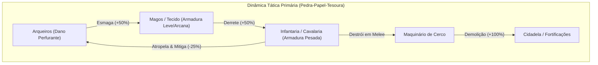
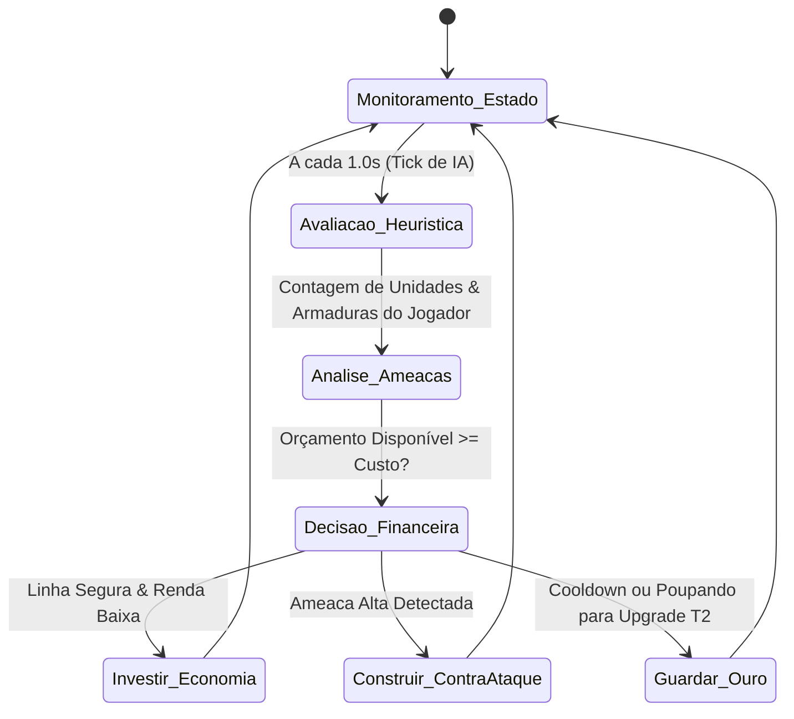

# Game Design Document (GDD) v1.0
# Tug of War: Citadels of Aethelgard

> **Documento Oficial de Engenharia de Sistemas & Balanceamento**  
> **Status:** Aprovado para Implementação — Marco MVP  
> **Autor:** Game Systems & Balance Designer  
> **Destinatários:** Gerente de Projetos (GP), Engenharia de Software, QA Estrutural, Equipe de Game Design  
> **Data:** Novembro de 2026  
> **Versão:** 1.0.0-PROD  

---

## Sumário Executivo
1. [Visão Geral do Jogo (High Concept)](#1-visão-geral-do-jogo-high-concept)
2. [Core Loop da Partida (Batalha em Tempo Real)](#2-core-loop-da-partida-batalha-em-tempo-real)
3. [Sistema de Estruturas Geradoras & Unidades (Reino da Coroa Solar)](#3-sistema-de-estruturas-geradoras--unidades-reino-da-coroa-solar)
4. [Matemática de Combate & Matriz Pedra-Papel-Tesoura](#4-matemática-de-combate--matriz-pedra-papel-tesoura)
5. [Estrutura de Progressão Single-Player Roguelike](#5-estrutura-de-progressão-single-player-roguelike)
6. [Comportamento da IA Inimiga (Single-Player)](#6-comportamento-da-ia-inimiga-single-player)
7. [Requisitos de Arquitetura & Guia de Handoff (Engenharia & QA)](#7-requisitos-de-arquitetura--guia-de-handoff-engenharia--qa)

---

## 1. Visão Geral do Jogo (High Concept)

### 1.1 O Que é o Jogo?
**Tug of War: Citadels of Aethelgard** é um jogo tático de estratégia e cabo de guerra linear (*Line Auto-Battler*, na linhagem de mapas clássicos como *Nexus Wars* e *Castle Fight*), fundido com um sistema de progressão procedural **Roguelike Single-Player** na estrutura de mapa de nós (inspirado em *Slay the Spire*).

O jogador assume o comando de um Soberano da Cidadela. Em cada batalha em tempo real, gerencia um orçamento contínuo de Ouro para erguer **Estruturas Geradoras** em sua retaguarda. Essas estruturas produzem automaticamente levas de combatentes que marcham ao longo de um corredor de guerra horizontal, colidindo contra as forças inimigas. A vitória ocorre ao aniquilar a Cidadela/Nexus inimiga antes que a própria fortaleza seja destruída. Entre as batalhas de uma campanha (*Run*), o jogador escolhe caminhos em um mapa de nós, adquire **Relíquias Reais** com efeitos sinérgicos modificadores de regras e aprimora seu baralho de projetos militares.

### 1.2 Pilares de Design
1. **Macro-Decisões em Tempo Real com Execução Automatizada (Zero Micro):** O jogador não controla unidades individuais em campo. O triunfo decorre do timing de investimento econômico, posicionamento inteligente no grid e leitura analítica da composição inimiga.
2. **Tensão Perpétua de Cabo de Guerra (*Tug of War*):** O centro gravitacional do combate oscila fisicamente pela arena. Conquistar território inimigo concede bônus de ímpeto moral, enquanto ser empurrado para os portões da cidadela ativa defesas desesperadas de retaguarda.
3. **Profundidade Sistêmica & Pedra-Papel-Tesoura Rígido:** Não existe unidade universalmente superior. Tipos de dano e armadura criam contra-ataques objetivos (ex.: dano perfurante aniquila atiradores leves, mas bate inofensivamente em placas de aço; magos derretem armaduras pesadas, mas sucumbem a cargas de cavalaria veloz).
4. **Construção de Builds Emergentes (Roguelike Replayability):** Relíquias e decretos reais alteram radicalmente o valor relativo das unidades a cada tentativa de campanha, incentivando especializações assimétricas (ex.: build de explosão de infantaria sacrificial vs. cerco hiper-defensivo de longo alcance).

### 1.3 Plataforma, Motor & Apresentação Visual
- **Plataforma-Alvo:** Navegadores Web Desktop modernos (Chrome, Firefox, Edge, Safari) via WebAssembly/Canvas HTML5 com suporte a WebGL.
- **Stack Tecnológica:** TypeScript puro para a simulação lógica headless; Vite como bundler; HTML5 Canvas / Phaser 3 como camada de renderização e áudio.
- **Perspectiva:** Visão lateral 2D com leve inclinação isométrica (*Side-Scroller tático 2.5D* em faixa horizontal de combate).
- **Temática e Direção de Arte:** Fantasia Medieval Épica. A primeira facção jogável é o **Reino da Coroa Solar** — cavaleiros em armaduras polidas de aço e ouro, teurgistas de chamas solares, arqueiros de baluarte e maquinários de cerco de carvalho sagrado.

### 1.4 Condições Formais de Vitória e Derrota
- **Vitória de Batalha:** Reduzir o HP do Nexus/Cidadela Inimigo (posicionado no extremo direito da arena, coordenada lógica $X = 2000$) a exatamente $0$.
- **Derrota de Batalha / Fim da Run:** O HP da Cidadela do Jogador (posicionada no extremo esquerdo da arena, coordenada lógica $X = 0$) chega a $0$.
- **Vitória da Campanha:** Vencer as batalhas dos 3 Atos e derrotar o Chefe Final no último nó do Ato 3.

```mermaid
flowchart LR
    A["Início da Run (Ato 1)"] --> B["Nó do Mapa (Batalha / Evento)"]
    B --> C{"Tipo de Nó?"}
    C -->|Batalha / Elite / Boss| D["Arena em Tempo Real (Nexus vs Nexus)"]
    C -->|Acampamento / Fogueira| E["Reparar Cidadela ou Aprimorar Tecnologia"]
    C -->|Mercador Errante| F["Comprar Relíquias e Decretos"]
    D --> G{"Cidadela Inimiga Destruída?"}
    G -->|Sim| H["Recompensa: Ouro + Escolha de 1 entre 3 Relíquias"]
    G -->|Não (Cidadela Aliada Caiu)| I["Fim da Run (Game Over)"]
    H --> J{"Chefe do Ato 3 Vencido?"}
    J -->|Sim| K["Vitória Suprema da Campanha"]
    J -->|Não| B
    E --> B
    F --> B
```

---

## 2. Core Loop da Partida (Batalha em Tempo Real)

### 2.1 Dimensões Lógicas e Geometria da Arena
A simulação física e posicional opera em um espaço cartesiano contínuo 2D, dissociado de pixels de monitor:

$$\text{Largura Total } (X): 0 \text{ a } 2000 \text{ unidades lógicas}$$
$$\text{Altura Útil da Faixa de Batalha } (Y): 100 \text{ a } 500 \text{ unidades lógicas } (\text{Espessura da Pista} = 400)$$

```
[ RETAGUARDA JOGADOR ]       [ CORREDOR DE COMBATE - CABO DE GUERRA ]       [ RETAGUARDA INIMIGA ]
[-350 a 0]   [X = 0]         [X = 0 a 800]    [800 a 1200]    [1200 a 2000]       [X = 2000]   [2000 a 2350]
+---------+  +-------------+ +-------------+  +------------+  +-------------+     +----------+ +-----------+
| Grid de |  | CIDADELA DO | | Território  |  | ZONA DE    |  | Território  |     | CIDADELA | | Grid de   |
| Constr. |  | JOGADOR     | | Aliado      |  | DISPUTA    |  | Inimigo     |     | INIMIGA  | | Constr.   |
| (4 x 3) |  | (HP: 2500)  | |             |  | CENTRAL    |  |             |     | (HP: 2500| | IA (4 x 3)|
+---------+  +-------------+ +-------------+  +------------+  +-------------+     +----------+ +-----------+
                                              <-- X=1000 -->
                                               (Ponto Neutro)
```

#### Zonas Estruturadas do Campo de Batalha:
1. **Zona de Construção Aliada ($X \in [-350, -50]$):**
   - Grid reservado de $4 \times 3$ slots (12 slots no total).
   - Onde o jogador posiciona suas Estruturas Geradoras de Tropas.
   - Unidades geradas surgem no portal da Cidadela ($X = 0$) e marcham rumo a $+X$.
2. **Cidadela do Jogador ($X = 0$):**
   - Ponto de origem das unidades aliadas. Possui $2500$ de HP e Armadura Fortificada ($25\%$ de mitigação contra dano comum, $200\%$ vulnerabilidade a cerco).
3. **Território de Defesa Aliada ($X \in [0, 800]$):**
   - Se o combate ocorrer majoritariamente nesta zona, a Cidadela ativa auxílio balístico.
4. **Zona de Disputa Neutra / Linha de Frente Central ($X \in [800, 1200]$):**
   - O centro perfeito é $X = 1000$. A zona de choque onde as primeiras levas colidem.
5. **Território de Avanço Ofensivo ($X \in [1200, 2000]$):**
   - Zona de pressão em solo inimigo que confere bônus moral às tropas aliadas.
6. **Cidadela Inimiga ($X = 2000$):**
   - Alvo primário de vitória. Possui atributos simétricos de $2500$ de HP e Armadura Fortificada.
7. **Zona de Construção Inimiga ($X \in [2050, 2350]$):**
   - Grid espelhado de $4 \times 3$ slots onde a IA posiciona suas estruturas. Suas unidades marcham rumo a $-X$.

#### Dispersão no Eixo Vertical ($Y$):
As unidades não marcham em uma linha unidimensional estrita para evitar sobreposição total (*sprite stacking* feio e irrealista). Ao spawnar, cada unidade recebe um ponto de âncora vertical aleatório na faixa $Y \in [150, 450]$. Um sistema de repulsão suave (*Soft Collision Separation*) afasta unidades amigas adjacentes, enquanto o algoritmo de combate as atrai para o inimigo mais próximo dentro do seu raio de engajamento.

---

### 2.2 O Mecanismo de Cabo de Guerra (*Frontline Push*)
A cada tick de simulação, a engine calcula o **Ponto de Frente de Batalha ($\bar{X}_{\text{front}}$)**:

$$\bar{X}_{\text{front}} = \frac{1}{N_{\text{engajados}}} \sum_{i=1}^{N_{\text{engajados}}} X_i$$

Onde unidades engajadas são aquelas que estão ativamente atacando ou sendo atacadas.

#### Dinâmica de Pressão Territorial:
- **Ímpeto da Vanguarda (Avanço Além de $X > 1200$ por mais de $5.0\text{ s}$ contínuos):**
  - Todas as unidades aliadas ganham o status passivo *Moral Radiante*: $+15\%$ de Velocidade de Movimento e geram $+1\text{ Ouro}$ extra a cada $5.0\text{ s}$ de controle territorial.
- **Baluarte do Desespero (Retirada Abaixo de $X < 800$ por mais de $5.0\text{ s}$ contínuos):**
  - A Cidadela Aliada dispara balistas automáticas das muralhas a cada $2.0\text{ s}$, causando $60$ de Dano Perfurante na unidade inimiga mais avançada.
- **Feedback Visual da UI:** Um medidor horizontal no topo da tela (*Tug-of-War Gauge*) oscila suavemente entre azul (jogador) e vermelho (inimigo), indicando qual lado está sustentando a pressão territorial.

---

### 2.3 Economia em Tempo Real (Ouro & Renda)

A economia da partida é o eixo estratégico central do gênero. O jogador precisa decidir constantemente entre **investir em Renda (crescimento exponencial tardio)** ou **erguer Unidades Militares imediatas (sobrevivência no front)**.

#### 1. Renda Passiva de Base (*Base Income*)
- **Ouro Inicial:** $120\text{ Ouro}$.
- **Intervalo de Renda (*Income Tick*):** Ocorre a cada $5.0\text{ segundos}$ de tempo de jogo.
- **Renda Base (Nível 0):** $12\text{ Ouro}$ por ciclo ($2.4\text{ Ouro/s}$).

#### 2. Tesouraria / Mina Real (Upgrades de Renda Econômica)
O aprimoramento de renda não consome slots militares do grid; é operado através de um botão dedicado na interface de comando da Cidadela.

| Nível da Mina Real | Custo de Compra (Ouro) | Nova Renda por Ciclo (a cada 5s) | Ganho Líquido por Ciclo | Taxa Efetiva de Ouro/s | Tempo de Amortização (*Payback Period*) |
| :--- | :---: | :---: | :---: | :---: | :---: |
| **Nível 0 (Base)** | Grátis | $12\text{ Ouro}$ | - | $2.40\text{ Ouro/s}$ | - |
| **Nível 1 (Mina de Cobre)** | $60\text{ Ouro}$ | $18\text{ Ouro}$ | $+6\text{ Ouro}$ | $3.60\text{ Ouro/s}$ | $50.0\text{ segundos}$ (10 ciclos) |
| **Nível 2 (Mina de Prata)** | $110\text{ Ouro}$ | $26\text{ Ouro}$ | $+8\text{ Ouro}$ | $5.20\text{ Ouro/s}$ | $68.75\text{ segundos}$ (13.75 ciclos) |
| **Nível 3 (Mina de Ouro)** | $180\text{ Ouro}$ | $36\text{ Ouro}$ | $+10\text{ Ouro}$ | $7.20\text{ Ouro/s}$ | $90.0\text{ segundos}$ (18 ciclos) |
| **Nível 4 (Tesouro Régio)**| $270\text{ Ouro}$ | $48\text{ Ouro}$ | $+12\text{ Ouro}$ | $9.60\text{ Ouro/s}$ | $112.5\text{ segundos}$ (22.5 ciclos) |

> [!IMPORTANT]
> **A Regra de Ouro do Nexus Wars:** Se o jogador investir cegamente em Mina de Prata enquanto o adversário constrói Quartéis e Estábulos, o exército inimigo chegará à Cidadela antes do tempo de amortização da mina se pagar, resultando em derrota sumária. O timing do investimento em economia deve ser feito quando a linha de combate estiver estabilizada além de $X = 1000$.

#### 3. Recompensa por Abate (*Bounties*)
Para recompensar defesas táticas eficientes e evitar que o jogador que está perdendo seja esmagado sem chances de reação (*snowball irreversível*), cada unidade inimiga destruída concede uma pequena quantia imediata de Ouro para o tesouro de quem realizou o abate:
- Unidades de Baixo Custo / T1: $1 \text{ a } 2\text{ Ouro}$
- Unidades Intermediárias / T2: $3 \text{ a } 4\text{ Ouro}$
- Unidades de Cerco / Pesadas: $5 \text{ a } 8\text{ Ouro}$

---

## 3. Sistema de Estruturas Geradoras & Unidades (Reino da Coroa Solar)

O MVP traz a facção completa **Reino da Coroa Solar**, composta por 5 Estruturas Geradoras de Tropas. Cada estrutura possui **Nível 1** e pode receber um **Upgrade para Nível 2** durante a partida. O upgrade substitui permanentemente o tipo de unidade gerada por uma versão de elite avançada, sem reiniciar o timer do ciclo de spawn atual.

```
       [Quartel da Guarda] -----> Escudeiro (N1) ----------> Cavaleiro Real (N2)
       [Campo de Arquearia] ----> Arqueiro Longo (N1) ------> Besteiro de Cerco (N2)
BASE   [Torre Arcana] ----------> Aprendiz Solar (N1) ------> Arquimago Solar (N2)
       [Estábulo de Guerra] ----> Lanceiro Montado (N1) ----> Paladino da Alvorada (N2)
       [Forja de Cerco] --------> Balista Móvel (N1) -------> Catapulta de Fogo Grego (N2)
```

### 3.1 Tabela Mestra de Estruturas e Unidades (Balanceamento MVP v1.0)

| ID da Estrutura | Nome da Estrutura | Custo Const. (Ouro) | Custo Upgr. (Ouro) | Spawn Cooldown (s) | Nome da Unidade | HP Máx | Tipo Armad. | Redução Plana | Dano Base | Interv. Ataque (s) | DPS Base | Alcance (px) | Vel. Mov. (px/s) | Tipo Dano | Bounty (Ouro) |
| :--- | :--- | :---: | :---: | :---: | :--- | :---: | :---: | :---: | :---: | :---: | :---: | :---: | :---: | :---: | :---: |
| `bldg_barracks_1` | **Quartel da Guarda** | 100 | - | 12.0s | **Escudeiro** | 380 | Pesada | 1 | 18 | 1.2s | 15.0 | 40 (Melee) | 65 | Normal | 2 |
| `bldg_barracks_2` | **Quartel Real (Upgr)** | - | 130 | 12.0s | **Cavaleiro Real** | 720 | Pesada | 3 | 36 | 1.2s | 30.0 | 45 (Melee) | 60 | Normal | 4 |
| `bldg_archery_1` | **Campo Arquearia** | 90 | - | 10.0s | **Arqueiro Longo** | 170 | Leve | 0 | 22 | 1.1s | 20.0 | 380 (Ranged) | 70 | Perfurante| 2 |
| `bldg_archery_2` | **Guarnição Besteiros**| - | 120 | 11.0s | **Besteiro Cerco** | 290 | Leve | 1 | 55 | 1.6s | 34.4 | 420 (Ranged) | 65 | Perfurante| 4 |
| `bldg_arcane_1` | **Torre Arcana** | 125 | - | 14.0s | **Aprendiz Solar**| 180 | Arcana | 0 | 32 | 1.5s | 21.3 | 320 (Ranged) | 65 | Mágico | 3 |
| `bldg_arcane_2` | **Santuário Solar (Upgr)**| - | 160 | 15.0s | **Arquimago Solar**| 340 | Arcana | 1 | 68 | 1.7s | 40.0 | 360 (Ranged) | 65 | Mágico | 5 |
| `bldg_stable_1` | **Estábulo de Guerra** | 140 | - | 16.0s | **Lanceiro Montado**| 420 | Pesada | 1 | 28 | 1.0s | 28.0 | 50 (Melee) | 120 | Normal | 3 |
| `bldg_stable_2` | **Cavalaria Sagrada** | - | 175 | 17.0s | **Paladino Alvorada**| 850 | Pesada | 2 | 52 | 1.1s | 47.3 | 55 (Melee) | 110 | Normal | 6 |
| `bldg_siege_1` | **Forja de Cerco** | 160 | - | 22.0s | **Balista Móvel** | 310 | Fortificada| 2 | 90 | 2.5s | 36.0 | 580 (Siege) | 45 | Cerco | 4 |
| `bldg_siege_2` | **Oficina de Catapulta**| - | 210 | 25.0s | **Catapulta Fogo** | 480 | Fortificada| 3 | 160 | 3.2s | 50.0 | 680 (Siege) | 40 | Cerco | 7 |

---

### 3.2 Detalhamento e Habilidades Únicas das Unidades

#### 1. Linha do Quartel da Guarda (Tanques de Primeira Linha)
- **Papel Tático:** Absorver punição na vanguarda, segurando a linha de combate para que arqueiros e magos causem dano livremente da retaguarda.
- **Escudeiro (N1):**
  - *Passiva - Formação de Escudos:* Recebe $-20\%$ de dano de ataques perfurantes à distância.
- **Cavaleiro Real (N2):**
  - *Passiva - Placas de Aethelgard:* Redução plana de armadura aumentada para $3$.
  - *Habilidade Ativa - Golpe Esmagador:* A cada 3 ataques básicos, o próximo causa $+50\%$ de dano e empurra o alvo $20\text{ px}$ para trás.

#### 2. Linha do Campo de Arquearia (DPS Sustentado à Distância)
- **Papel Tático:** Aniquilar unidades de armadura leve e apoiar a destruição de magos inimigos.
- **Arqueiro Longo (N1):**
  - *Passiva - Saraivada Rápida:* Ganha $+15\%$ de velocidade de ataque se permanecer parado por mais de $3.0\text{ s}$.
- **Besteiro de Cerco (N2):**
  - *Passiva - Virote Perfurador:* Ataques perfuram a armadura inimiga, ignorando $50\%$ da Redução Plana do alvo e causando $120\%$ de dano contra alvos acima de $600\text{ HP}$.

#### 3. Linha da Torre Arcana (Dano Mágico em Área & Anti-Armadura)
- **Papel Tático:** O contra-ataque mandatório contra frentes densas de Cavaleiros e Paladinos de armadura pesada.
- **Aprendiz Solar (N1):**
  - *Ataque Mágico Básico:* Seus ataques causam dano radial pequeno de $40\text{ px}$ ao redor do alvo principal.
- **Arquimago Solar (N2):**
  - *Habilidade Ativa - Supernova da Alvorada:* A cada 4 ataques, invoca um feixe de luz solar que atinge uma área de $100\text{ px}$, causando $110$ de Dano Mágico em todos os inimigos atingidos e reduzindo a velocidade de ataque deles em $25\%$ por $3.0\text{ s}$.

#### 4. Linha do Estábulo de Guerra (Choque, Velocidade e Flanqueamento)
- **Papel Tático:** Romper rapidamente o espaço entre as linhas, atropelar a linha de frente e alcançar os atiradores/magos frágeis da retaguarda adversária.
- **Lanceiro Montado (N1):**
  - *Habilidade - Ímpeto de Carga:* Ao avistar o primeiro inimigo a uma distância entre $150\text{ e }300\text{ px}$, dispara em disparada acelerada ($220\text{ px/s}$). O primeiro ataque causa $200\%$ de Dano Normal.
- **Paladino da Alvorada (N2):**
  - *Habilidade - Carga Sagrada:* O impacto da carga causa $250\%$ de Dano Normal e atordoa o alvo principal por $1.0\text{ s}$.
  - *Passiva - Aura de Devoção:* Unidades aliadas a até $120\text{ px}$ do Paladino recebem $+1$ de Redução Plana de Armadura.

#### 5. Linha da Forja de Cerco (Artilharia de Longo Alcance & Quebra de Cidadela)
- **Papel Tático:** Fogo de suporte a longa distância capaz de punir aglomerações e causar danos devastadores à Cidadela inimiga a partir de uma distância segura.
- **Balista Móvel (N1):**
  - *Disparo Linear:* O virote maciço atravessa até 2 alvos em linha reta até atingir o ponto de impacto máximo. Alcance mínimo de $150\text{ px}$ (não consegue atacar alvos que colarem em seu corpo).
- **Catapulta de Fogo Grego (N2):**
  - *Bombardeio Incendiário:* Arremessa vasos de fogo com dispersão AoE de $120\text{ px}$. O impacto cria uma poça de fogo no chão que persiste por $4.0\text{ s}$, causando $25$ de dano mágico por segundo a qualquer unidade inimiga que pisar sobre ela. Causa $200\%$ de dano contra o Nexus inimigo. Alcance mínimo de $180\text{ px}$.

---

## 4. Matemática de Combate & Matriz Pedra-Papel-Tesoura

O sistema de combate rejeita casualidade excessiva: o resultado de confrontos isolados é altamente determinístico, premiando composições bem orquestradas.

### 4.1 A Matriz de Multiplicadores de Dano vs. Armadura

| Tipo de Dano \ Tipo de Armadura | Leve | Pesada | Arcana | Fortificada (Estrutura/Cerco) |
| :--- | :---: | :---: | :---: | :---: |
| **Normal / Cortante** | $100\%$ ($1.00$) | $100\%$ ($1.00$) | $125\%$ ($1.25$) | $50\%$ ($0.50$) |
| **Perfurante** | **$150\%$ ($1.50$)** | $75\%$ ($0.75$) | $100\%$ ($1.00$) | $35\%$ ($0.35$) |
| **Mágico** | $75\%$ ($0.75$) | **$150\%$ ($1.50$)** | $75\%$ ($0.75$) | $50\%$ ($0.50$) |
| **Cerco** | $50\%$ ($0.50$) | $50\%$ ($0.50$) | $75\%$ ($0.75$) | **$200\%$ ($2.00$)** |



### 4.2 A Fórmula Oficial de Resolução de Dano
Para cada ataque registrado na simulação lógica, o cálculo do dano efetivo subtraído do HP da vítima segue a seguinte fórmula exata:

$$\text{Dano Efetivo} = \max\left(1, \left\lfloor \left( \text{Dano Base} \times M_{\text{tipo}} \times \prod \text{Modificadores de Relíquia} \right) - \text{Redução Plana} \right\rfloor \right)$$

Onde:
- $\text{Dano Base}$: Valor bruto de ataque da unidade atacante.
- $M_{\text{tipo}}$: Multiplicador escalar obtido na Matriz de Dano vs. Armadura (ex.: $1.50$ para Perfurante em Leve).
- $\prod \text{Modificadores de Relíquia}$: Produto cumulativo de bônus globais ativos (ex.: $1.20$ para relíquia de dano).
- $\text{Redução Plana}$: Valor inteiro de proteção da armadura da unidade defensora (ex.: $3$ para Cavaleiro Real).
- $\max(1, \dots)$: Todo ataque bem-sucedido causa no mínimo $1$ ponto de dano garantido (evita invulnerabilidade absoluta).
- $\lfloor \dots \rfloor$: Arredondamento para baixo (*floor*), garantindo valores inteiros determinísticos para sincronização.

#### Exemplo Prático de Teste Unitário 1: Arqueiro Longo atacando Escudeiro
- Atacante: Arqueiro Longo ($\text{Dano Base} = 22$, Tipo Perfurante).
- Defensor: Escudeiro ($\text{Armadura} = \text{Pesada}$, $\text{Redução Plana} = 1$).
- $M_{\text{tipo}} = 0.75$ (Perfurante vs Pesada).
- Cálculo: $\lfloor (22 \times 0.75) - 1 \rfloor = \lfloor 16.5 - 1 \rfloor = \lfloor 15.5 \rfloor = 15 \text{ de dano}$.

#### Exemplo Prático de Teste Unitário 2: Aprendiz Solar atacando Cavaleiro Real
- Atacante: Aprendiz Solar ($\text{Dano Base} = 32$, Tipo Mágico).
- Defensor: Cavaleiro Real ($\text{Armadura} = \text{Pesada}$, $\text{Redução Plana} = 3$).
- $M_{\text{tipo}} = 1.50$ (Mágico vs Pesada).
- Cálculo: $\lfloor (32 \times 1.50) - 3 \rfloor = \lfloor 48.0 - 3 \rfloor = 45 \text{ de dano}$.
- *Análise de Eficiência:* O dano mágico ignora o peso da armadura pesada e amplifica o dano drasticamente.

#### Exemplo Prático de Teste Unitário 3: Catapulta atacando a Cidadela Inimiga
- Atacante: Catapulta de Fogo Grego ($\text{Dano Base} = 160$, Tipo Cerco).
- Defensor: Cidadela Inimiga ($\text{Armadura} = \text{Fortificada}$, $\text{Redução Plana} = 5$).
- $M_{\text{tipo}} = 2.00$ (Cerco vs Fortificada).
- Cálculo: $\lfloor (160 \times 2.00) - 5 \rfloor = \lfloor 320 - 5 \rfloor = 315 \text{ de dano por pedrada}$.

### 4.3 Sistema de Mira e Prioridade de Alvos (*Targeting Heuristic*)
As unidades reavaliam seu alvo a cada intervalo de ataque conforme as seguintes regras estritas:
1. **Regra de Provocação (Taunt):** Se houver uma unidade inimiga com status *Provocador* dentro do alcance de visão, ela se torna o alvo prioritário mandatório.
2. **Regra de Alcance Mínimo:** Unidades com alcance mínimo (Balistas e Catapultas) descartam qualquer inimigo posicionado a uma distância inferior a seu limiar de disparo.
3. **Regra de Maior Proximidade:** Dentre os alvos elegíveis dentro do alcance de ataque, a unidade escolhe o inimigo com menor distância Euclidiana $\Delta d = \sqrt{(X_2 - X_1)^2 + (Y_2 - Y_1)^2}$.
4. **Alvo Padrão (Sem Inimigos no Alcance):** A unidade avança em velocidade de cruzeiro na direção da Cidadela adversária até avistar um inimigo ou entrar em alcance de tiro do Nexus adversário.

---

## 5. Estrutura de Progressão Single-Player Roguelike

A campanha de **Tug of War: Citadels of Aethelgard** é estruturada em uma jornada de **3 Atos**, projetada para sessões de 25 a 45 minutos. O HP da Cidadela do Jogador **persiste** entre as batalhas de um mesmo Ato, exigindo escolhas conscientes entre ganância de recursos e conservação de integridade estrutural.

### 5.1 O Grafo de Nós do Ato
Cada Ato é composto por **7 camadas de profundidade (colunas)** conectadas de forma procedural através de bifurcações direcionadas:

```
[Entrada] --> [Camada 1] --> [Camada 2] --> [Camada 3] --> [Camada 4] --> [Camada 5] --> [Camada 6] --> [CHEFE DO ATO]
 (Início)      Batalha        Batalha /      Elite /        Acampamento    Batalha /      Mercador /     Guardião da
               Comum          Mercador       Evento                        Elite          Acampamento    Fortaleza
```

#### Tipos de Nós Disponíveis:
1. **Batalha Padrão (Ícone de Espadas Cruzadas):** Combate contra um comandante de IA comum. Recompensa: Ouro de Campanha ($40 \text{ a } 60$) + Escolha de 1 entre 3 Decretos Reais/Relíquias Comuns.
2. **Batalha de Elite (Ícone de Elmo Dourado):** Combate de alto risco contra um exército de IA com modificadores hostis ativos (ex.: $+20\%$ de HP inimigo ou renda acelerada). Recompensa: Grande soma de Ouro ($90 \text{ a } 120$) + Relíquia de Raridade Rara ou Épica garantida.
3. **Evento de Encruzilhada (Ícone de Interrogação):** Encontro narrativo com 2 a 3 escolhas de dilema moral/estratégico (ex.: *"Pagar 50 de ouro para abençoar seus lanceiros"* ou *"Saquear um vilarejo para ganhar 100 de ouro, mas o Nexus perde 400 de HP"*).
4. **Acampamento / Fogueira da Guarda (Ícone de Fogueira):** Ponto seguro sem combate. O jogador escolhe exatamente **uma** das seguintes ações:
   - *Reparar Muralhas:* Restaura $35\%$ do HP máximo da Cidadela.
   - *Forja de Campo:* Concede $+10\%$ de dano permanente a uma classe específica de unidades pelo restante da Run.
   - *Inspiração Soberana:* Começa a próxima batalha com $+50$ de Ouro inicial de batalha.
5. **Mercador Errante (Ícone de Balança):** Permite gastar o Ouro de Campanha acumulado para comprar Relíquias específicas, poções de reparo emergencial de Nexus ou banir uma estrutura indesejada do repertório.
6. **Chefe do Ato (Ícone de Coroa de Caveira):** Confronto monumental contra um comandante de IA lendário com mecânicas próprias e geradores exclusivos. Vencê-lo conclui o Ato, regenera $100\%$ do HP da Cidadela e abre o baú de Relíquia Lendária.

---

### 5.2 Sistema de Decretos Reais & Relíquias (8 Relíquias Iniciais do MVP)

Ao final de cada batalha bem-sucedida, o jogador recebe uma tela de escolha de **1 entre 3 Relíquias aleatórias**. Relíquias são artefatos passivos que se acumulam no inventário da campanha, permitindo a criação de *builds* ultra-especializadas e quebradas.

| # | Nome da Relíquia | Raridade | Efeito Matemático Estrito | Sinapse Estratégica / Arquétipo |
| :-: | :--- | :---: | :--- | :--- |
| **01** | **Decreto do Martírio Solar** | Rara | Quando qualquer unidade corpo a corpo aliada (*Escudeiro, Cavaleiro, Lanceiro*) morre, ela explode causando **$60\text{ de Dano Mágico}$** em uma área de $80\text{ px}$. | Transforma infantaria barata em bombas vivas contra aglomerações e cavalarias inimigas. |
| **02** | **Doutrina da Produção Febril** | Incomum | O tempo de recarga de spawn de todas as estruturas aliadas é reduzido em **$-15\%$**, mas todas as unidades aliadas geradas têm seu HP máximo reduzido em **$-10\%$**. | Estratégia de enxame de alto volume (*Swarm / DPS Rush*). |
| **03** | **Virotes da Alvorada Flamejante**| Rara | A cada **$5º\text{ ataque}$** disparado por atiradores (*Arqueiro, Besteiro*), o projétil causa uma explosão ígnea que inflige **$160\text{ de Dano Mágico}$** em área de $70\text{ px}$. | Concede dano em área massivo para builds focadas em atiradores de linha. |
| **04** | **Estandarte de Sangue e Solo** | Comum | Enquanto o Ponto de Frente de Combate ($\bar{X}_{\text{front}}$) estiver em território inimigo ($X > 1200$), todas as unidades aliadas causam **$+20\%$ de Dano Global**. | Recompensa builds agressivas de avanço contínuo com *snowball* implacável. |
| **05** | **Blindagem Benta dos Justos** | Incomum | Unidades aliadas com **Armadura Pesada** recebem **$-2$ de Dano Plano adicional** de todos os ataques físicos (Normal e Perfurante), com piso mínimo de $1$ de dano. | Torna Cavaleiros e Paladinos praticamente imunes a disparos de arqueiros comuns. |
| **06** | **Carga da Alvorada Triunfante** | Épica | O primeiro impacto de carga da Cavalaria causa **$+150\%$ de dano adicional** ($350\%$ no total para Lanceiro, $400\%$ para Paladino) e atordoa o alvo por **$1.5\text{ segundos}$**. | Cria uma força de choque devastadora capaz de exterminar instantaneamente tanques inimigos. |
| **07** | **Dízimo de Guerra Régio** | Comum | Abater qualquer unidade inimiga com Dano Mágico ou de Cerco concede **$+100\%$ de Bounty em Ouro** (recompensa dobrada). | Acelera brutalmente o motor financeiro ao jogar com Magos e Balistas. |
| **08** | **Coração de Mana da Cidadela** | Épica | A cada **$30.0\text{ segundos}$** de batalha, a Cidadela Aliada dispara uma onda de choque arcana que atravessa todo o mapa, curando todas as tropas amigas em **$120\text{ HP}$** e infligindo **$80\text{ de Dano Mágico}$** a todas as tropas inimigas em campo. | Estabilizador de emergência e limpador de levas para estratégias de *late game* e cerco lento. |

---

## 6. Comportamento da IA Inimiga (Single-Player)

A inteligência artificial adversária foi projetada para emular um oponente humano experiente de *Nexus Wars*, sem trapacear na simulação física. Ela opera sob as mesmas regras orçamentárias e restrições de tempo de recarga que o jogador, exceto em dificuldades elevadas ou nós de Chefe, onde recebe multiplicadores específicos de desafio.



### 6.1 Os 4 Perfis de Personalidade da IA

#### 1. Perfil Agressivo / Rush ("Comandante Valerius")
- **Filosofia:** Investe zero Ouro em melhorias de Mina Real no início do jogo.
- **Padrão de Construção:** Foca em erguer $2$ Quartéis imediatos e $1$ Estábulo de Guerra nos primeiros 40 segundos de partida.
- **Objetivo:** Forçar a linha de combate para os portões da cidadela do jogador ($X < 400$) antes que o jogador consiga tirar proveito de qualquer investimento econômico.

#### 2. Perfil Defensivo / Artilharia de Cerco ("Grão-Marechal Thorne")
- **Filosofia:** Prioriza o controle territorial lento, sustentado e inexpugnável.
- **Padrão de Construção:** Ergue $1$ Quartel de Infantaria Pesada na linha de frente, seguido de $2$ Campos de Arquearia e $1$ Forja de Cerco (Balista). Investe em Nível 1 e 2 de Mina Real assim que atinge estabilidade defensiva.
- **Objetivo:** Acumular uma muralha de escudos intransponível enquanto 2 a 3 máquinas de cerco bombardeiam a Cidadela aliada de longe.

#### 3. Perfil Enxame / Horda de Choque ("Rainha dos Salteadores Seline")
- **Filosofia:** Sobrecarregar o sistema de mira e o DPS unitário do jogador através de volume numérico massivo de unidades de baixo custo.
- **Padrão de Construção:** Multiplica geradores de baixo custo (Quartéis N1 e Arqueiros N1) e Estábulos de mobilidade rápida.
- **Ponto Fraco Intencional:** Extremamente vulnerável a ataques de área (Magos com dano em área ou Catapultas).

#### 4. Perfil Boss ("O Tirano de Ferro" - Chefe do Ato 1)
- **Modificadores Especiais:**
  - Começa a batalha com $200\text{ Ouro}$ de tesouro inicial.
  - Multiplicador de Renda passiva: $1.25\times$.
  - Possui uma estrutura única de Chefe: **Altar dos Renegados**, que a cada $45.0\text{ s}$ invoca um *Guerreiro Colossal* (1800 HP, Armadura Pesada 4, Dano Normal 75).

### 6.2 O Algoritmo de Avaliação de Composição (Matriz de Contra-Ataque)
A cada tick de decisão da IA ($1.0\text{ s}$ lógico), o script avalia o vetor de ameaça do exército do jogador em campo:

$$\text{Ameaça}_{\text{Pesada}} = \sum \text{HP de unidades com Armadura Pesada do Jogador}$$
$$\text{Ameaça}_{\text{Leve}} = \sum \text{HP de unidades com Armadura Leve do Jogador}$$
$$\text{Ameaça}_{\text{Cerco}} = \sum \text{Contagem de Balistas e Catapultas do Jogador}$$

**Lógica de Reação Automatizada:**
- Se $\text{Ameaça}_{\text{Pesada}} > 1200$ e a IA possui menos de 2 Torres Arcanas: Prioridade máxima para construir **Torre Arcana** (ou aprimorar para Arquimago Solar).
- Se $\text{Ameaça}_{\text{Leve}} > 800$ e a IA possui pouca linha de retaguarda: Prioridade para construir **Campo de Arquearia** (Dano Perfurante destrói armaduras leves).
- Se o jogador possui mais de 2 máquinas de cerco ativas: Prioridade para erguer **Estábulo de Guerra** (Cavalaria rápida para flanquear e alcançar a artilharia antes do disparo).
- Se a linha de combate está estabilizada em território inimigo ($X > 1100$) e a IA tem mais de $80\text{ de Ouro}$: Investir em **Upgrade de Mina Real**.

---

## 7. Requisitos de Arquitetura & Guia de Handoff (Engenharia & QA)

Para viabilizar que o **Gerente de Projetos (GP)** e os Engenheiros de Software implementem o sistema sem retrabalho e com cobertura integral de testes unitários determinísticos, a arquitetura deve obedecer rigorosamente às diretrizes abaixo.

### 7.1 Separação Estrita: Core Simulation Engine vs. Renderer/UI
A simulação do jogo deve ser concebida como uma aplicação **Headless (sem interface gráfica)**. Nenhuma classe matemática de combate ou entidade de simulação pode importar bibliotecas de renderização (Phaser, PIXI, Canvas, Three.js ou objetos da DOM como `window` ou `document`).

```
+-------------------------------------------------------------------------------+
|                             CAMADA DE VISUALIZAÇÃO                            |
|             (Phaser 3 / HTML5 Canvas / Web Audio / UI DOM Overlay)            |
+---------------------------------------+---------------------------------------+
                                        |  Assina Eventos
                                        |  Lê Snapshots Visuais (60 FPS Interp.)
                                        v
+-------------------------------------------------------------------------------+
|                       MOTOR DETERMINÍSTICO DE SIMULAÇÃO                       |
|                          (Core Engine Headless em TypeScript)                 |
|                                                                               |
|  - Fixed Timestep Loop (ex: 20 Ticks/s = 50ms por Tick)                       |
|  - Gerador de Números Pseudo-Aleatórios Semeado (PRNG Seeded Mulberry32)     |
|  - Gerenciador de Entidades e Componentes (Posição X/Y, HP, Cooldowns)        |
|  - Matriz de Combate & Resolução de Dano Inteiro                              |
|  - Barramento de Eventos de Domínio (Event Bus Desacoplado)                   |
+-------------------------------------------------------------------------------+
```

#### O Ciclo de Ticks da Simulação (*Fixed Timestep*):
- A engine lógica roda a uma frequência fixa de **$20\text{ TPS}$ (Ticks Por Segundo)** ou **$30\text{ TPS}$** (um tick a cada $50\text{ ms}$ ou $33.33\text{ ms}$).
- A camada visual de renderização roda desacoplada a **$60\text{ FPS}$** (ou na taxa de atualização nativa do monitor do usuário), interpolando linearmente as posições dos sprites entre os dois últimos snapshots da simulação lógica:

$$X_{\text{render}} = X_{\text{tick\_anterior}} + \alpha \cdot (X_{\text{tick\_atual}} - X_{\text{tick\_anterior}})$$

#### Eventos do Barramento de Domínio (*Domain Event Bus*):
A simulação emite eventos tipados que o renderer escuta para disparar animações e áudio:
- `UnitSpawnedEvent { unitId, type, team, x, y }`
- `UnitAttackedEvent { attackerId, targetId, damage, isCritical }`
- `UnitDiedEvent { unitId, killerId, bountyAwarded, x, y }`
- `StructureBuiltEvent { structureId, slotIndex, type, team }`
- `StructureUpgradedEvent { structureId, newType, team }`
- `NexusDamagedEvent { team, currentHp, maxHp }`
- `BattleEndedEvent { winnerTeam, durationInTicks }`

---

### 7.2 Roadmap Proposto de Sprints para o MVP (Plano para o GP)

| Sprint | Duração | Foco Principal | Entregáveis Chave da Sprint |
| :---: | :---: | :--- | :--- |
| **Sprint 1** | 2 Semanas | **Fundação do Core Headless & Arena Linear Básica** | - Loop determinístico com PRNG semeado.<br>- Sistema de coordenadas 2D e movimentação de unidades.<br>- Grid de construção de slots 4x3 para o jogador.<br>- Estruturas 1 e 2 (Quartel e Arquearia) em Nível 1 funcionais.<br>- Nexus com HP e colisão.<br>- Testes unitários de mitigação de dano. |
| **Sprint 2** | 2 Semanas | **Arsenal Completo, IA Oponente & Integração Phaser 3** | - Implementação dos 5 geradores e seus upgrades Nível 2.<br>- Matriz 4x4 de dano vs armadura 100% calibrada.<br>- IA oponente operando com perfis Agressivo e Defensivo.<br>- Renderizador Phaser 3 acoplado ao Event Bus.<br>- Interface de compra de geradores e upgrade de renda. |
| **Sprint 3** | 2 Semanas | **Metagame Roguelike, Relíquias & Balanceamento** | - Grafo procedural de nós de campanha (7 nós por Ato).<br>- Sistema de inventário e aplicação matemática das 8 Relíquias.<br>- Batalha de Chefe do Ato 1.<br>- Sistema de persistência local da campanha (LocalStorage/JSON).<br>- Polimento de áudio, VFX de impacto e testes de stress. |

---

### 7.3 Critérios de Aceite & Matriz de Testes (QA & Engenharia)

#### 1. Testes de Validação de Game Design (Básicos / Regras de Negócio)
- [ ] **Teste de Invariância da Matriz de Dano:** Validar que cada um dos 16 cruzamentos da tabela de Dano vs. Armadura produz o multiplicador percentual exato especificado na Seção 4.1.
- [ ] **Teste de Consistência Econômica:** Garantir que o ouro não seja criado do nada. Se a renda é de $18\text{ Ouro}$ a cada $5.0\text{ s}$, o saldo após $30\text{ s}$ deve ser exatamente $\text{Saldo Inicial} + (6 \times 18) - \text{Gastos Realizados}$.
- [ ] **Teste de Reembolso de Venda:** Se uma estrutura for demolida/vendida, deve devolver exatamente $60\%$ do ouro acumulado investido nela (arredondado para baixo).
- [ ] **Teste de Alcance Mínimo:** Validar que Balistas e Catapultas cessam o disparo ou buscam alvos distantes se uma unidade inimiga estiver a menos de $150\text{ px}$ ou $180\text{ px}$ de distância, respectivamente.

#### 2. Testes Estruturais de Engenharia & QA (Arquitetura & Robustez)
- [ ] **Teste de Determinismo Bit-a-Bit (Replayability Test):**
  - Executar a simulação de uma batalha de 3 minutos de forma headless com uma semente de PRNG fixa (`seed = 123456`).
  - Executar a mesma batalha uma segunda vez em outro processo ou ambiente.
  - O hash SHA-256 do estado final da simulação (HP das Cidadelas, unidades vivas e ouro restante) deve ser **$100\%$ idêntico**.
- [ ] **Stress Test de Performance & Garbage Collection (200 Unidades Simultâneas):**
  - Spawna forçado de 100 unidades em cada lado do campo de batalha com combate ativo contínuo.
  - O tick time da simulação lógica não pode ultrapassar **$5\text{ ms}$ por tick** em uma CPU moderna padrão de escritório (margem de segurança para os $50\text{ ms}$ disponíveis por tick).
  - O framerate da camada Phaser 3 deve se sustentar acima de **$55\text{ FPS}$** estáveis, sem *stuttering* causado por alocação excessiva de memória ou picos de Garbage Collection (uso obrigatório de *Object Pooling* para projéteis e unidades).
- [ ] **Teste de Integridade de Fronteira (Boundary Check):**
  - Nenhuma unidade pode ultrapassar as coordenadas lógicas $X < 0$ ou $X > 2000$. Ao alcançar o Nexus inimigo, a unidade deve parar sua marcha e passar a atacar a estrutura do Nexus.

---

## 8. Glossário Técnico & Nomenclatura
- **Line Auto-Battler / Tug of War:** Subgênero estratégico onde unidades se enfrentam autonomamente ao longo de um corredor unidimensional/bidimensional e a vitória é determinada pelo avanço contínuo da linha de combate.
- **EHP (Effective Health Points):** Quantidade real de dano bruto que uma unidade suporta antes de morrer, calculada após mitigações de tipo de armadura e redução plana: $\text{EHP} = \frac{\text{HP}}{1 - \text{Mitigação}}$.
- **DPS (Damage Per Second):** Dano nominal dividido pelo tempo de recarga entre ataques: $\text{DPS} = \frac{\text{Dano}}{\text{Intervalo}}$.
- **Object Pooling:** Padrão de projeto arquitetural que reutiliza instâncias de objetos em memória (como virotes, flechas e partículas de dano) em vez de instanciar e destruir elementos constantemente, eliminando picos de Garbage Collector no navegador.
- **Headless Simulation:** Execução integral da lógica de jogo sem interface visual acoplada, essencial para testes automatizados rápidos de balanceamento e partidas simuladas a $1000\times$ a velocidade normal.

---
*Fim do Documento — Tug of War: Citadels of Aethelgard GDD v1.0*
