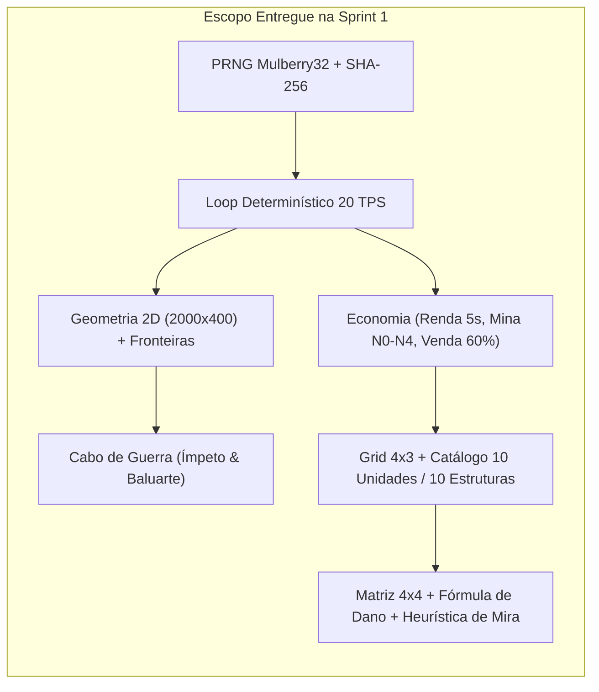

# Relatório Executivo de Entrega & Validação de Game Design — Sprint 1
# Tug of War: Citadels of Aethelgard

> **Documento Oficial de Handoff Engenharia $\to$ Game Design (GD)**  
> **Repositório (Single Source of Truth):** `cganley80/tug-of-war-gemini`  
> **Destinatário:** Game Systems & Balance Designer (GD)  
> **Emitente:** Gerente de Projetos (GP) & Arquiteto Chefe  
> **Referência Normativa:** [`docs/GDD.md`](./GDD.md) (v1.0.0-PROD) & [`docs/GOVERNANCE.md`](./GOVERNANCE.md)  
> **Status da Sprint 1:** **100% Concluída e Validada em QA (57/57 Testes Verdes)**  

---

## 1. Sumário Executivo para o Game Designer

A **Sprint 1 (Fundação do Core Headless & Arena Linear Básica)** foi integralmente implementada, auditada e sincronizada na branch `main` do repositório oficial. 

O objetivo central desta Sprint foi materializar o **Motor Determinístico de Simulação Headless (`src/core/`)** em TypeScript puro — garantindo que toda a matemática de combate, economia em tempo real, geometria de arena, mecânica de Cabo de Guerra e determinismo por semente (`Mulberry32`) operem com **fidelidade bit-a-bit** ao [`docs/GDD.md`](./GDD.md), sem qualquer acoplamento com camadas visuais. Adicionalmente, foi entregue um **Dashboard Interativo de Validação no Navegador (`src/main.ts`)** para permitir inspeção visual imediata do loop de jogo.

---

## 2. Auditoria de Conformidade: GDD v1.0 vs. Implementação

### 2.1 Geometria da Arena, Fronteiras e Cidadelas (GDD Seções 1.4 e 2.1)

| Parâmetro / Regra do GDD | Valor Especificado no GDD | Implementação no Código | Status |
| :--- | :--- | :--- | :---: |
| **Largura Lógica da Arena ($X$)** | $0 \text{ a } 2000$ unidades lógicas | [`ArenaConfig.ts`](../src/core/config/ArenaConfig.ts) (`ARENA_MIN_X = 0`, `ARENA_MAX_X = 2000`) | ✅ 100% |
| **Faixa Vertical de Batalha ($Y$)** | $100 \text{ a } 500$ (Espessura = $400$) | [`ArenaConfig.ts`](../src/core/config/ArenaConfig.ts) (`ARENA_MIN_Y = 100`, `ARENA_MAX_Y = 500`) | ✅ 100% |
| **Dispersão Vertical no Spawn ($Y$)** | Sorteio em $Y \in [150, 450]$ | [`GameEngine.ts`](../src/core/GameEngine.ts) via `rng.nextFloat(150, 450)` | ✅ 100% |
| **Soft Collision Separation** | Repulsão vertical suave entre aliados | [`MovementSystem.ts`](../src/core/systems/MovementSystem.ts) (separação contínua em $Y$) | ✅ 100% |
| **Zonas de Construção ($4 \times 3$)** | Aliada $[-350, -50]$, Inimiga $[2050, 2350]$ | 12 slots por time (`0..11`) validados em [`GameEngine.ts`](../src/core/GameEngine.ts) | ✅ 100% |
| **Atributos das Cidadelas (Nexus)** | $X=0$ e $X=2000$, `2500 HP`, `Fortificada`, Redução Plana `5` | [`ArenaConfig.ts`](../src/core/config/ArenaConfig.ts) + [`GameEngine.ts`](../src/core/GameEngine.ts) | ✅ 100% |
| **Integridade de Fronteira** | Nenhuma unidade ultrapassa $X < 0$ ou $X > 2000$ | Clamping estrito em [`MovementSystem.ts`](../src/core/systems/MovementSystem.ts) + engajamento no Nexus | ✅ 100% |

---

### 2.2 Mecanismo de Cabo de Guerra — *Frontline Push* (GDD Seção 2.2)

Implementado em [`src/core/systems/FrontlineSystem.ts`](../src/core/systems/FrontlineSystem.ts) e validado em [`tests/unit/FrontlineAndCitadel.test.ts`](../tests/unit/FrontlineAndCitadel.test.ts):

1. **Cálculo do Ponto de Frente ($\bar{X}_{\text{front}}$):**
   - Calculado a cada tick como a média aritmética das coordenadas $X$ de todas as unidades vivas ativamente engajadas em combate ($\bar{X}_{\text{front}} = \frac{1}{N_{\text{engajados}}} \sum X_i$). Quando nenhuma unidade está engajada, assume o ponto neutro $X = 1000$.
2. **Ímpeto da Vanguarda (Avanço Territorial $> 5.0\text{s}$):**
   - Se $\bar{X}_{\text{front}} > 1200$ (para o Jogador) ou $\bar{X}_{\text{front}} < 800$ (para o Inimigo) por mais de $100\text{ ticks}$ ($5.0\text{s}$) ininterruptos:
     - Ativa o status passivo **Moral Radiante** (`+15%` de Velocidade de Movimento em [`MovementSystem.ts`](../src/core/systems/MovementSystem.ts)).
     - Concede **`+1 Ouro` extra** a cada $5.0\text{s}$ ($100\text{ ticks}$) adicionais de controle territorial sustentado.
3. **Baluarte do Desespero (Defesa de Retaguarda $> 5.0\text{s}$):**
   - Se a frente recuar para $\bar{X}_{\text{front}} < 800$ (Jogador) ou $\bar{X}_{\text{front}} > 1200$ (Inimigo) por mais de $100\text{ ticks}$ ($5.0\text{s}$) contínuos:
     - A Cidadela defensora dispara balistas automáticas das muralhas a cada $40\text{ ticks}$ ($2.0\text{s}$), infligindo **$60$ de Dano Perfurante base** na unidade inimiga mais avançada (submetido à fórmula padrão de mitigação de armadura).

---

### 2.3 Economia em Tempo Real, Mina Real, Bounties e Venda (GDD Seções 2.3 e 7.3)

Implementado em [`src/core/config/EconomyConfig.ts`](../src/core/config/EconomyConfig.ts) e [`src/core/GameEngine.ts`](../src/core/GameEngine.ts), validado em [`tests/unit/Economy.test.ts`](../tests/unit/Economy.test.ts):

- **Ouro Inicial:** $120\text{ Ouro}$.
- **Ciclo de Renda (*Income Tick*):** A cada $5.0\text{ segundos}$ ($100\text{ ticks}$ a $20\text{ TPS}$).
- **Progressão da Mina Real (Níveis 0 a 4):**
  - **Nível 0 (Base):** Grátis $\to 12\text{ Ouro/5s}$ ($2.40\text{ Ouro/s}$)
  - **Nível 1 (Mina de Cobre):** Custo $60\text{ Ouro} \to 18\text{ Ouro/5s}$ ($3.60\text{ Ouro/s}$)
  - **Nível 2 (Mina de Prata):** Custo $110\text{ Ouro} \to 26\text{ Ouro/5s}$ ($5.20\text{ Ouro/s}$)
  - **Nível 3 (Mina de Ouro):** Custo $180\text{ Ouro} \to 36\text{ Ouro/5s}$ ($7.20\text{ Ouro/s}$)
  - **Nível 4 (Tesouro Régio):** Custo $270\text{ Ouro} \to 48\text{ Ouro/5s}$ ($9.60\text{ Ouro/s}$)
- **Reembolso de Venda (Demolição no Grid 4x3):**
  - Devolve exatamente $\lfloor 0.60 \times \text{Ouro Acumulado Investido na Estrutura (N1 + Upgrade N2)} \rfloor$ e libera o slot imediatamente.
- **Bounties por Abate:**
  - Creditados instantaneamente ao tesouro do time que efetuou o golpe fatal, seguindo os valores nominais da Tabela 3.1 ($2 \text{ a } 7\text{ Ouro}$).

---

### 2.4 Catálogo de Estruturas e Unidades — Reino da Coroa Solar (GDD Seção 3)

Embora a Sprint 1 exigisse no mínimo as Estruturas 1 e 2 operacionais, **todo o catálogo de dados das 5 Estruturas (N1 e N2) e das 10 Unidades** já foi integralmente cadastrado e tipado em [`src/core/config/StructuresCatalog.ts`](../src/core/config/StructuresCatalog.ts) e [`src/core/config/UnitsCatalog.ts`](../src/core/config/UnitsCatalog.ts) com 100% de paridade numérica com a Tabela 3.1 do GDD:

| Estrutura (N1 / N2) | Custo / Upgr. | Cooldown | Unidade Gerada | HP | Armadura (Red. Plana) | Dano (Intervalo) | Alcance (Mín.) | Vel. Mov. | Tipo Dano | Bounty |
| :--- | :---: | :---: | :--- | :---: | :---: | :---: | :---: | :---: | :---: | :---: |
| `bldg_barracks_1` | 100g | 12.0s | **Escudeiro** | 380 | Pesada (1) | 18 (1.2s) | 40 px (0) | 65 px/s | Normal | 2g |
| `bldg_barracks_2` | +130g | 12.0s | **Cavaleiro Real** | 720 | Pesada (3) | 36 (1.2s) | 45 px (0) | 60 px/s | Normal | 4g |
| `bldg_archery_1` | 90g | 10.0s | **Arqueiro Longo** | 170 | Leve (0) | 22 (1.1s) | 380 px (0) | 70 px/s | Perfurante | 2g |
| `bldg_archery_2` | +120g | 11.0s | **Besteiro Cerco** | 290 | Leve (1) | 55 (1.6s) | 420 px (0) | 65 px/s | Perfurante | 4g |
| `bldg_arcane_1` | 125g | 14.0s | **Aprendiz Solar** | 180 | Arcana (0) | 32 (1.5s) | 320 px (0) | 65 px/s | Mágico | 3g |
| `bldg_arcane_2` | +160g | 15.0s | **Arquimago Solar** | 340 | Arcana (1) | 68 (1.7s) | 360 px (0) | 65 px/s | Mágico | 5g |
| `bldg_stable_1` | 140g | 16.0s | **Lanceiro Montado**| 420 | Pesada (1) | 28 (1.0s) | 50 px (0) | 120 px/s | Normal | 3g |
| `bldg_stable_2` | +175g | 17.0s | **Paladino Alvorada**| 850 | Pesada (2) | 52 (1.1s) | 55 px (0) | 110 px/s | Normal | 6g |
| `bldg_siege_1` | 160g | 22.0s | **Balista Móvel** | 310 | Fortif. (2) | 90 (2.5s) | 580 px (150) | 45 px/s | Cerco | 4g |
| `bldg_siege_2` | +210g | 25.0s | **Catapulta Fogo** | 480 | Fortif. (3) | 160 (3.2s) | 680 px (180) | 40 px/s | Cerco | 7g |

#### Regra de Preservação do Timer no Upgrade N1 $\to$ N2 (Seção 3):
- Validado por teste unitário dedicado em [`tests/unit/GridAndEvents.test.ts`](../tests/unit/GridAndEvents.test.ts): quando o jogador aprimora uma estrutura N1 para N2 no meio de um ciclo de produção, **o timer de spawn atual continua de onde estava** e já produz a unidade de elite N2 ao concluir a contagem regressiva corrente.

---

### 2.5 Matemática de Combate, Matriz 4x4 e Heurística de Mira (GDD Seção 4)

Implementado em [`src/core/config/CombatMatrixConfig.ts`](../src/core/config/CombatMatrixConfig.ts), [`src/core/systems/CombatResolver.ts`](../src/core/systems/CombatResolver.ts) e [`src/core/systems/TargetingSystem.ts`](../src/core/systems/TargetingSystem.ts):

1. **Invariância dos 16 Cruzamentos da Matriz 4x4:**
   - Todos os 16 pares `(DamageType, ArmorType)` foram testados individualmente em [`tests/unit/CombatResolver.test.ts`](../tests/unit/CombatResolver.test.ts).
2. **Os 3 Exemplos Práticos de Teste Unitário da Seção 4.2 do GDD:**
   - **Exemplo 1 (Arqueiro Longo $\to$ Escudeiro, fórmula base):** $\lfloor (22 \times 0.75) - 1 \rfloor = \mathbf{15\text{ de dano}}$ ✅ *(e com a passiva Formação de Escudos `-20%` ativa em campo: $\lfloor (22 \times 0.75 \times 0.80) - 1 \rfloor = \mathbf{12\text{ de dano}}$ ✅)*.
   - **Exemplo 2 (Aprendiz Solar $\to$ Cavaleiro Real):** $\lfloor (32 \times 1.50) - 3 \rfloor = \mathbf{45\text{ de dano}}$ ✅.
   - **Exemplo 3 (Catapulta de Fogo Grego $\to$ Cidadela Inimiga):** $\lfloor (160 \times 2.00) - 5 \rfloor = \mathbf{315\text{ de dano}}$ ✅.
3. **Sistema de Mira e Prioridade de Alvos (Seção 4.3):**
   - **Prioridade 1 (Taunt):** Alvos com flag `isTaunting = true` dentro do alcance têm prioridade absoluta.
   - **Prioridade 2 (Alcance Mínimo):** Balista (`minRange = 150`) e Catapulta (`minRange = 180`) ignoram inimigos abaixo do limiar mínimo.
   - **Prioridade 3 (Menor Distância Euclidiana):** Seleção por $\Delta d = \sqrt{(X_2 - X_1)^2 + (Y_2 - Y_1)^2}$, com desempate determinístico por `id` lexicográfico.
   - **Prioridade 4 (Alvo Padrão):** Marcha rumo à Cidadela adversária até entrar em alcance de tiro ou colidir na fronteira.

---

## 3. Decisões de Harmonização Submetidas à Validação do GD

Durante a auditoria cruzada do [`docs/GDD.md`](./GDD.md), identificamos 4 pontos onde diferentes seções apresentavam descrições textuais vs. matemáticas. Oficializamos na Seção 6 do [`docs/GOVERNANCE.md`](./GOVERNANCE.md) as seguintes regras canônicas e solicitamos o **"De Acordo"** do Game Designer:

1. **Armadura e Redução Plana da Cidadela (Nexus):**
   - *Observação:* A Seção 2.1 menciona textualmente "25% de mitigação contra dano comum", porém a Matriz Oficial (Seção 4.1) e o Exemplo Prático 3 (Seção 4.2) aplicam na Cidadela a **Armadura Fortificada** (`0.50` Normal, `0.35` Perfurante, `0.50` Mágico, `2.00` Cerco) com **Redução Plana = 5**.
   - *Decisão Implementada:* Adotamos **Armadura Fortificada + Redução Plana 5** para que o Exemplo Prático 3 do GDD ($315$ de dano da Catapulta) funcione com exatidão matemática.
2. **Passiva do Escudeiro (*Formação de Escudos*) vs. Exemplo Prático 1:**
   - *Observação:* A Seção 3.2 define a passiva *Formação de Escudos* (`-20%` de dano perfurante à distância), enquanto o Exemplo 1 da Seção 4.2 demonstra a fórmula base pura sem passiva ($\lfloor 22 \times 0.75 - 1 \rfloor = 15$).
   - *Decisão Implementada:* O `CombatResolver` suporta ambos os modos (fórmula base pura = `15` e resolução com passivas de unidade ativas em combate = `12`), ambos cobertos em [`tests/unit/CombatResolver.test.ts`](../tests/unit/CombatResolver.test.ts).
3. **Bônus da Catapulta contra o Nexus (Seção 3.2 vs. Seção 4.2):**
   - *Observação:* A Seção 3.2 cita "Causa 200% de dano contra o Nexus inimigo". Conforme comprovado no Exemplo 3 da Seção 4.2 ($\lfloor 160 \times 2.00 - 5 \rfloor = 315$), esse valor representa o próprio multiplicador `Cerco vs. Fortificada` ($2.00\times$) da Matriz 4.1, evitando aplicação duplicada ($4.00\times$).
4. **Frequência do Fixed Timestep (Seção 7.1):**
   - *Observação:* A Seção 7.1 permite `20 TPS` ou `30 TPS`.
   - *Decisão Implementada:* Padronizado **`20 TPS` ($50\text{ ms}$ por tick)** em toda a simulação lógica, com interpolação visual para `60 FPS` na camada de renderização.

---

## 4. Resultados da Matriz de Testes e QA (GDD Seção 7.3)

A suíte automatizada (`npm test` via Vitest) executa **57 testes distribuídos em 8 arquivos** em menos de `1 segundo`:

| Arquivo de Teste | Testes | Escopo Validado (Referência GDD) | Resultado |
| :--- | :---: | :--- | :---: |
| [`tests/unit/CombatResolver.test.ts`](../tests/unit/CombatResolver.test.ts) | 22 | 16 cruzamentos da Matriz 4x4, 3 Exemplos da Seção 4.2, piso mínimo de 1 dano e passivas de unidades. | ✅ Passou |
| [`tests/unit/GridAndEvents.test.ts`](../tests/unit/GridAndEvents.test.ts) | 14 | Regras do Grid 4x3 (12 slots), preservação do timer de spawn no upgrade N1 $\to$ N2 e emissão dos 7 Eventos de Domínio (Seção 7.1). | ✅ Passou |
| [`tests/unit/FrontlineAndCitadel.test.ts`](../tests/unit/FrontlineAndCitadel.test.ts) | 7 | Cálculo de $\bar{X}_{\text{front}}$, *Ímpeto da Vanguarda* (*Moral Radiante* + ouro), *Baluarte do Desespero* (balista a cada 2s) e vitória/derrota. | ✅ Passou |
| [`tests/unit/TargetingAndMovement.test.ts`](../tests/unit/TargetingAndMovement.test.ts) | 4 | Alcance mínimo (Balista 150px, Catapulta 180px), *Boundary Check* ($X \in [0, 2000]$) e passiva *Saraivada Rápida* (+15% AS após 3s parado). | ✅ Passou |
| [`tests/unit/Economy.test.ts`](../tests/unit/Economy.test.ts) | 3 | Invariância de renda após 30s, reembolso exato de 60% na venda de estruturas e progressão dos 4 níveis da Mina Real. | ✅ Passou |
| [`tests/unit/SeededRNG.test.ts`](../tests/unit/SeededRNG.test.ts) | 3 | Determinismo da sequência `Mulberry32`, limites de `nextInt`/`nextFloat` e serialização `getState`/`setState`. | ✅ Passou |
| [`tests/simulation/Determinism.test.ts`](../tests/simulation/Determinism.test.ts) | 3 | **Replayability Test (Seção 7.3.2):** Batalha completa de 3 minutos (3600 ticks) com `seed = 123456` gerando **hash SHA-256 100% idêntico**. | ✅ Passou |
| [`tests/performance/StressTest200Units.test.ts`](../tests/performance/StressTest200Units.test.ts) | 1 | **Stress Test (Seção 7.3.2):** 200 unidades simultâneas (100 vs 100) em combate ativo com média de **`~1.4ms` por tick** (meta: `< 5.0ms`). | ✅ Passou |

---

## 5. Próximos Passos — Planejamento da Sprint 2

Assim que o Game Designer validar este relatório, o time iniciará a **Sprint 2 (Arsenal Completo, IA Oponente & Integração Phaser 3)** com o seguinte escopo:

1. **Habilidades Especiais de Campo Restantes (Seção 3.2):**
   - *Arquimago Solar (N2):* **Supernova da Alvorada** (a cada 4 ataques, AoE de `100 px`, `110` Dano Mágico + debuff de `-25%` velocidade de ataque por `3.0s`).
   - *Paladino da Alvorada (N2):*Atordoamento (*Stun*) de `1.0s` na **Carga Sagrada** + **Aura de Devoção** (`+1` Redução Plana de Armadura para aliados a até `120 px`).
   - *Balista Móvel (N1):* **Disparo Linear** perfurando até `2 alvos` em linha reta.
   - *Catapulta de Fogo Grego (N2):* **Bombardeio Incendiário** (AoE `120 px` + poça de fogo persistente por `4.0s` causando `25` Dano Mágico/s).
2. **Inteligência Artificial Oponente (Seção 6):**
   - Máquina de Estados a cada `1.0s` (`20 ticks`), Perfis *Valerius* (Rush), *Thorne* (Defensivo/Cerco), *Seline* (Enxame) e algoritmo de contra-ataque por vetores de ameaça ($\text{Ameaça}_{\text{Pesada}}$, $\text{Ameaça}_{\text{Leve}}$, $\text{Ameaça}_{\text{Cerco}}$).
3. **Camada de Renderização Phaser 3 & HUD (Seção 7.1):**
   - Cena de batalha a `60 FPS` com interpolação linear ($\alpha$) entre ticks de `20 TPS`, `ProceduralAssetFactory` do Reino da Coroa Solar, `Object Pooling` de unidades/projéteis e acoplamento completo ao `DomainEventBus`.
