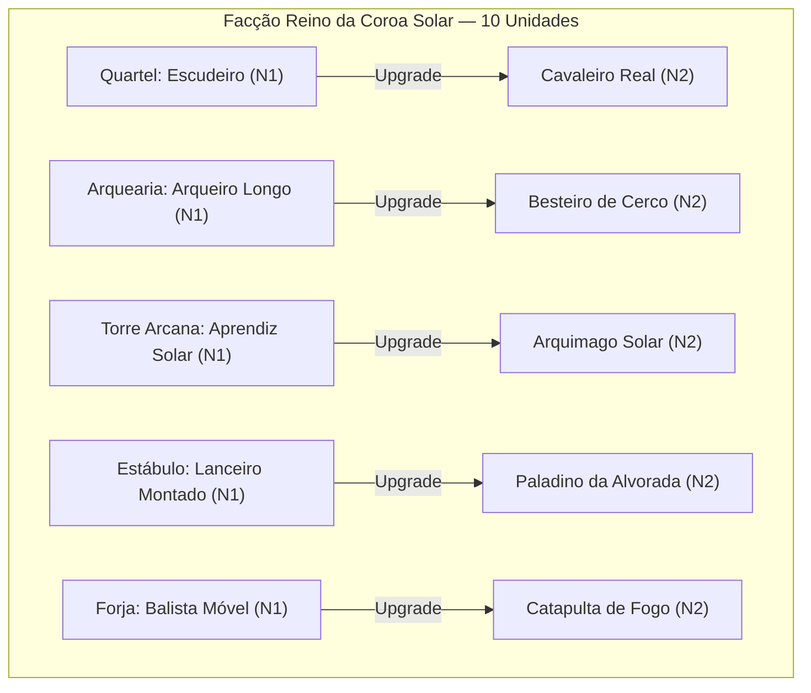
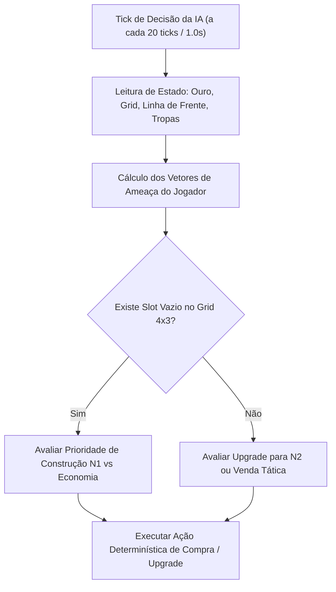

# Parecer de Sign-Off da Sprint 1 & Especificação Técnica de Game Design — Sprint 2
# Tug of War: Citadels of Aethelgard

> **Documento Normativo de Game Design & Transição de Engenharia**  
> **Status:** **OFICIALMENTE APROVADO & HOMOLOGADO (SIGN-OFF CONCEDIDO)**  
> **Autor:** Game Systems & Balance Designer  
> **Destinatários:** Gerente de Projetos (GP), Engenheiro de Core & IA (`core-architect`), Engenheiro de Gameplay & UI (`gameplay-ui-engineer`), Engenheiro de QA (`qa-automation`)  
> **Data de Homologação:** Novembro de 2026  
> **Versão de Referência:** [`docs/GDD.md`](./GDD.md) (v1.1 Harmonizado Pós-Sprint 1) & [`docs/GOVERNANCE.md`](./GOVERNANCE.md)  

---

## Sumário
1. [Seção 1 — Parecer Oficial de Game Design sobre a Sprint 1](#seção-1--parecer-oficial-de-game-design-sobre-a-sprint-1)
2. [Seção 2 — Especificação Matemática Estrita das Habilidades de Unidades (Sprint 2)](#seção-2--especificação-matemática-estrita-das-habilidades-de-unidades-sprint-2)
3. [Seção 3 — Especificação Algorítmica da IA Oponente (Seção 6 do GDD)](#seção-3--especificação-algorítmica-da-ia-oponente-seção-6-do-gdd)
4. [Seção 4 — Diretrizes de Game Feel, Renderização Phaser 3 e HUD Tático](#seção-4--diretrizes-de-game-feel-renderização-phaser-3-e-hud-tático)

---

## Seção 1 — Parecer Oficial de Game Design sobre a Sprint 1

### 1.1 Declaração Formal de Homologação
Na qualidade de **Game Systems & Balance Designer**, realizei a auditoria técnica e matemática completa do relatório [`docs/SPRINT_1_REPORT.md`](./SPRINT_1_REPORT.md), dos artefatos em `src/core/` e da suíte automatizada de testes (`tests/`).

> [!IMPORTANT]
> **PARECER DE GAME DESIGN:** **DE ACORDO / SIGN-OFF CONCEDIDO**.  
> Todas as entregas previstas para a Sprint 1 foram implementadas com fidelidade estrita às regras do jogo, demonstrando excelência arquitetural no isolamento headless e no determinismo matemático da simulação.

### 1.2 Ratificação dos Resultados de QA e Desempenho
1. **Determinismo Bit-a-Bit (`Mulberry32` + SHA-256):**
   - A invariância do hash de estado (`computeStateHash()`) ao longo de 3600 ticks ($180.0\text{ s}$ a $20\text{ TPS}$) sob a semente fixa `123456` foi validada em [`tests/simulation/Determinism.test.ts`](../tests/simulation/Determinism.test.ts). O motor garante reprodutibilidade bit-a-bit indispensável para partidas justas e replayability.
2. **Stress Test de Simulação (200 Unidades Simultâneas):**
   - O tempo de processamento lógico médio aferido de $\sim 1.4\text{ ms}$ por tick supera com ampla folga o teto de segurança orçado de $< 5.0\text{ ms}$ por tick (em um frame de $50\text{ ms}$ a $20\text{ TPS}$), garantindo que sobra orçamento de CPU abundante para a camada visual no navegador.
3. **Suíte Automatizada:**
   - A totalidade dos $57$ testes unitários e de integração foi executada com $100\%$ de sucesso em tempo inferior a $1.0\text{ segundo}$.

### 1.3 Homologação das 4 Harmonizações Canônicas do GDD v1.1
Ficam formalmente chanceladas as seguintes definições canônicas, já incorporadas ao [`docs/GDD.md`](./GDD.md) (v1.1):
- **Cidadelas (Nexus Aliado e Inimigo):** $2500\text{ HP}$, `Armadura Fortificada` (multiplicadores de dano recebido: $0.50$ Normal, $0.35$ Perfurante, $0.50$ Mágico, $2.00$ Cerco) e $\text{Redução Plana} = 5$.
- **Catapulta de Fogo Grego:** O dano de $200\%$ contra a Cidadela representa o próprio multiplicador nativo da matriz `Cerco vs. Fortificada` ($2.00\times$), sem bônus duplicado.
- **Resolução de Dano Arqueiro vs. Escudeiro:** Ficam oficializados os dois cenários: $\mathbf{15\text{ de dano}}$ no teste isolado de matriz pura ($\lfloor 22 \times 0.75 - 1 \rfloor$) e $\mathbf{12\text{ de dano}}$ quando a passiva *Formação de Escudos* está ativa em combate simulado ($\lfloor 22 \times 0.75 \times 0.80 - 1 \rfloor$).
- **Frequência do Fixed Timestep:** Fica padronizado estritamente **$20\text{ TPS}$** ($\Delta t = 50\text{ ms} = 0.05\text{ s}$ por tick) em todo o ecossistema do motor.

### 1.4 Correções Mandatórias de Game Design Identificadas na Auditoria da Sprint 1 (Prioridade P0 na Sprint 2)
Embora os 57 testes unitários da Sprint 1 passem com sucesso, a **Auditoria Profunda de Game Design** identificou **3 distorções de gameplay** na implementação atual de `src/core/` que comprometem a experiência tática do jogo e devem ser corrigidas pelo GP como **Prioridade P0 na abertura da Sprint 2**:

1. **[P0 - CRÍTICO] Fim das "Unidades Melee Fantasmas" — Convergência Vertical de Interceptação (`Y-Steering`):**
   - **Problema Detectado em `MovementSystem.ts`:** As unidades nascem distribuídas em $Y \in [150, 450]$ ($300\text{ px}$ de faixa vertical), mas `MovementSystem.updateMovement()` desloca as unidades **apenas no eixo horizontal $X$**. Como o `TargetingSystem` mede distância Euclidiana 2D ($\sqrt{\Delta X^2 + \Delta Y^2} \le \text{attackRangePx}$) e unidades corpo a corpo possuem alcance curto (`Escudeiro = 40px`, `Cavaleiro = 45px`, `Lanceiro = 50px`), dois Escudeiros que nasçam em $Y = 170$ e $Y = 260$ ($\Delta Y = 90 > 40$) **caminham direto um pelo outro sem jamais entrar em combate**, destruindo a função de bloqueio de linha (Tank/Frontline) do gênero *Tug of War*.
   - **Regra Canônica para a Sprint 2:** Em `MovementSystem.updateMovement()`, quando uma unidade não estiver atacando e houver pelo menos um inimigo vivo dentro de um **Raio de Aquisição Tática (`AGGRO_RANGE_PX = 260`)** à sua frente (ou até $40\text{ px}$ atrás), a unidade deve convergir no eixo $Y$ na direção do inimigo mais próximo (ou usar o vetor normalizado $(\Delta X, \Delta Y)$ rumo a esse inimigo), garantindo que toda tropa *Melee* intercepte fisicamente os invasores na linha de frente.
2. **[P0 - BALANCEAMENTO] Exclusão do Alvo Primário no Dano Radial (`applySplashDamage` em `GameEngine.ts`):**
   - **Problema Detectado em `GameEngine.ts#L504-L545`:** Ao resolver o ataque de unidades com `aoeRadiusPx > 0` (*Aprendiz Solar* e *Catapulta*), o código aplica $100\%$ do dano no `target` principal (linha 420) e, em seguida, chama `applySplashDamage(unit, target.x, target.y, ...)` sem excluir `target.id` do filtro. Como o alvo primário está a distância $0$ de si mesmo, ele sofre um segundo golpe imediato de $+50\%$ de splash (**$150\%$ de dano single-target**).
   - **Regra Canônica para a Sprint 2:** `applySplashDamage` deve obrigatoriamente receber `primaryTargetId` e filtrar `u.id !== primaryTargetId`. O alvo central recebe $100\%$ do dano direto; apenas os inimigos secundários no raio recebem os $50\%$ de splash.
3. **[P0 - FIDELIDADE AO GDD] Cadência do *Golpe Esmagador* do Cavaleiro Real (`GameEngine.ts#L402`):**
   - **Problema Detectado em `GameEngine.ts#L402`:** A condição foi codificada como `(unit.attackCount + 1) % 4 === 0` (ativando a cada 4º ataque), divergindo da Seção 3.2 do GDD ("A cada 3 ataques básicos").
   - **Regra Canônica para a Sprint 2:** Ajustar para `(unit.attackCount + 1) % 3 === 0` (3º, 6º, 9º ataque).

---

## Seção 2 — Especificação Matemática Estrita das Habilidades de Unidades (Sprint 2)

Todas as habilidades devem ser implementadas no motor headless operando na base determinística de **$20\text{ TPS}$** ($\Delta t = 0.05\text{ s}$ por tick).



---

### 2.1 Linha do Quartel da Guarda

#### 1. Escudeiro (N1) — Passiva: *Formação de Escudos*
- **Gatilho:** Passivo contínuo avaliado em `CombatResolver.resolveDamage()`.
- **Condição Matemática:** 
  $$\text{Defensor} = \text{unit\_squire} \quad \land \quad \text{TipoDano} = \text{PIERCING} \quad \land \quad \text{isRangedAttack} = \text{true}$$
  *(Onde $\text{isRangedAttack}$ é verdadeiro para atacantes com alcance $> 60\text{ px}$).*
- **Efeito Numérico:** Multiplicador de passiva $M_{\text{passiva}} = 0.80$ (redução de $20\%$ no dano recebido).
- **Fórmula de Dano Aplicada:**
  $$\text{Dano Efetivo} = \max\left(1, \lfloor (\text{Dano Base} \times M_{\text{tipo}} \times 0.80) - \text{Redução Plana} \rfloor\right)$$
- **Casos de Borda:**
  - Ataques corpo a corpo (`isMelee = true`) que porventura causassem dano perfurante não ativam a passiva.
  - Ataques do tipo `NORMAL`, `MAGIC` ou `SIEGE` à distância não são mitigados por esta passiva (sofrem dano padrão da matriz).

#### 2. Cavaleiro Real (N2) — Habilidade Ativa: *Golpe Esmagador*
- **Gatilho:** A cada $3º\text{ ataque básico}$ deferido com sucesso contra um alvo (`(attackCount + 1) % 3 === 0` no momento do ataque).
- **Efeito Numérico:**
  1. Multiplicador de dano: $M_{\text{passiva}} = 1.50$ ($+50\%$ de dano adicional). Flag `isCritical = true`.
  2. Empurrão Mecânico (*Knockback*): O alvo sofre deslocamento horizontal instantâneo de $\mathbf{20\text{ px}}$ no eixo $X$ em direção à retaguarda do alvo:
     $$X_{\text{novo}} = \begin{cases} X_{\text{alvo}} + 20\text{ px}, & \text{se o atacante for do time PLAYER} \\ X_{\text{alvo}} - 20\text{ px}, & \text{se o atacante for do time ENEMY} \end{cases}$$
- **Casos de Borda:**
  - **Fronteira da Arena:** $X_{\text{novo}}$ deve ser obrigatoriamente clampeado em $[0, 2000]$. Uma unidade encostada na Cidadela adversária não pode ser empurrada para fora dos limites.
  - **Imunidade de Estruturas:** Se o alvo for a Cidadela/Nexus (`isTargetingCitadel = true`), o multiplicador de $+50\%$ de dano aplica-se normalmente, mas o deslocamento físico é **nulo** (estruturas são absolutamente estáticas).
  - Unidades atordoadas continuam recebendo knockback caso sejam atacadas.

---

### 2.2 Linha do Campo de Arquearia

#### 3. Arqueiro Longo (N1) — Passiva: *Saraivada Rápida*
- **Gatilho:** Passivo temporizado gerenciado em `MovementSystem.updateMovement()`.
- **Condição Matemática:** 
  $$\text{unit.ticksStationary} \ge 60\text{ ticks} \quad (3.0\text{ s a } 20\text{ TPS})$$
- **Rastreamento de Movimento:**
  - Se $|X_{\text{atual}} - X_{\text{anterior}}| < 0.0001\text{ px}$, incrementa `ticksStationary++`.
  - Se a unidade der qualquer passo ($|X_{\text{atual}} - X_{\text{anterior}}| \ge 0.0001\text{ px}$), `ticksStationary` é imediatamente resetado para $0$.
- **Efeito Numérico:**
  - Aceleração de ataque: $\text{Intervalo Efetivo} = \frac{\text{attackIntervalSec}}{1.15} = \frac{1.10\text{ s}}{1.15} \approx 0.9565\text{ s}$.
  - Em ticks de recarga: $\text{attackCooldownTicks} = \max(1, \text{round}(0.9565 \times 20)) = \mathbf{19\text{ ticks}}$ (em contraste com os $22\text{ ticks}$ padrão).
- **Casos de Borda:**
  - Se o alvo atual do Arqueiro morrer e houver outro inimigo dentro de seu raio de $380\text{ px}$, ele retargeta sem se mover, preservando os `ticksStationary` e mantendo a *Saraivada Rápida* ativa.

#### 4. Besteiro de Cerco (N2) — Passiva: *Virote Perfurador*
- **Gatilho:** Passivo em todos os ataques em `CombatResolver.resolveDamage()`.
- **Efeito Numérico Duplo:**
  1. **Perfuração de Armadura:** Ignora $50\%$ da Redução Plana do defensor:
     $$\text{Redução Plana Efetiva} = \lfloor \text{defenderFlatReduction} \times 0.5 \rfloor$$
  2. **Matador de Colossos:** Se $\text{defenderMaxHp} > 600$, concede multiplicador de dano de $1.20\times$ ($+20\%$ de dano):
     $$M_{\text{passiva}} = 1.20$$
- **Casos de Borda:**
  - O check de vida para o bônus de $+20\%$ avalia estritamente o $\text{maxHp}$ original da entidade (alvos válidos: Cavaleiro Real $720$, Paladino $850$ e Cidadela $2500$). Não decai se o HP atual do defensor cair abaixo de $600$.
  - Se o defensor tiver $\text{flatReduction} = 1$, $\lfloor 1 \times 0.5 \rfloor = 0$.

---

### 2.3 Linha da Torre Arcana

#### 5. Aprendiz Solar (N1) — *Ataque Mágico Radial*
- **Gatilho:** Impacto do ataque à distância ($320\text{ px}$).
- **Efeito Numérico:**
  - **Alvo Primário:** Recebe $100\%$ do dano mágico padrão ($32$ de Dano Base submetido à Matriz 4x4 e à Redução Plana do alvo).
  - **Alvos Secundários (Dano Radial):** Todas as unidades inimigas vivas dentro do raio euclidiano de $\mathbf{40\text{ px}}$ ao redor de $(X_{\text{alvo}}, Y_{\text{alvo}})$:
    $$\Delta d^2 = (X_i - X_{\text{alvo}})^2 + (Y_i - Y_{\text{alvo}})^2 \le 40^2 = 1600$$
    Recebem dano calculado com **$50\%$ do Dano Base** ($\lfloor 32 \times 0.5 \rfloor = 16\text{ Dano Mágico}$), submetido individualmente à fórmula de mitigação da armadura de cada unidade secundária.
- **Casos de Borda:**
  - O alvo primário não recebe o dano radial (evitando dano duplicado).
  - Se o alvo primário for a Cidadela, unidades que estejam passando ao lado da muralha a menos de $40\text{ px}$ sofrem o dano radial.

#### 6. Arquimago Solar (N2) — Habilidade Ativa: *Supernova da Alvorada*
- **Gatilho:** A cada $4º\text{ ataque}$ disparado (`attackCount % 4 === 0`).
- **Efeito Numérico:**
  1. **Dano em Área:** Em vez do ataque comum, invoca um feixe de luz que atinge uma área de raio de $\mathbf{100\text{ px}}$ centrado no alvo primário.
  2. **Dano Base Especial:** Utiliza **$110$ de Dano Mágico** (em vez dos $68$ padrão), aplicado a **todas** as unidades inimigas na área de $100\text{ px}$ (inclusive o primário), resolvido contra suas respectivas armaduras.
  3. **Debuff de Lentidão de Ataque (*Chama Solar*):** Todas as unidades inimigas atingidas recebem o status `Chama Solar`:
     - Redução de velocidade de ataque de **$25\%$** (multiplica o intervalo de ataque por $\frac{1}{0.75} \approx 1.333$).
     - Duração: $\mathbf{60\text{ ticks}}$ ($3.0\text{ s}$).
- **Casos de Borda:**
  - O debuff *Chama Solar* **não é cumulativo** em magnitude; novas aplicações apenas renovam o timer para $60\text{ ticks}$.
  - Cidadelas sofrem o dano da Supernova, mas são absolutamente imunes a alterações de velocidade ou debuffs.

---

### 2.4 Linha do Estábulo de Guerra

#### 7. Lanceiro Montado (N1) — Habilidade: *Ímpeto de Carga*
- **Condição de Detecção:** Enquanto em movimento livre e `hasCharged === false`, escaneia o corredor à frente. Se houver qualquer inimigo vivo com distância horizontal:
  $$150\text{ px} \le \Delta X_{\text{frente}} \le 300\text{ px}$$
- **Efeito de Movimentação:** A velocidade sobe imediatamente de $120\text{ px/s}$ para $\mathbf{220\text{ px/s}}$ até o encerramento da carga.
- **Impacto da Carga:** O primeiro ataque efetuado ao alcançar o alcance corpo a corpo ($50\text{ px}$) causa:
  $$M_{\text{passiva}} = 2.00 \quad (200\% \text{ de Dano Normal, } \text{isCritical} = \text{true})$$
- **Ciclo de Vida:** Após deferir o primeiro ataque, `hasCharged = true`. A unidade retorna à sua velocidade de cruzeiro ($120\text{ px/s}$) e não carrega novamente durante seu engajamento atual.
- **Casos de Borda:**
  - Caso o inimigo detectado morra durante a corrida e nenhum outro esteja na janela, a unidade encerra a aceleração ao alcançar o ponto de combate.

#### 8. Paladino da Alvorada (N2) — *Carga Sagrada* & *Aura de Devoção*
- **Habilidade 1 — *Carga Sagrada*:**
  - Aceleração idêntica à do Lanceiro ($220\text{ px/s}$ na janela $[150, 300]\text{ px}$).
  - No primeiro golpe: Causa **$250\%$ de Dano Normal** ($M_{\text{passiva}} = 2.50$, $\text{isCritical} = \text{true}$).
  - **Atordoamento (*Stun*):** Inflige $\mathbf{20\text{ ticks}}$ ($1.0\text{ s}$) de atordoamento no alvo primário atingido:
    $$\text{target.stunTicksRemaining} = 20$$
    Durante o Stun, o alvo não pode mover-se, atacar ou regenerar cooldowns.
- **Habilidade 2 — *Aura de Devoção* (Passiva de Área Contínua):**
  - Todas as unidades aliadas vivas situadas a uma distância euclidiana $\le \mathbf{120\text{ px}}$ do Paladino (incluindo o próprio Paladino) recebem:
    $$\text{Bônus de Redução Plana} = +1$$
- **Casos de Borda:**
  - **Não Cumulatividade de Auras:** A *Aura de Devoção* não acumula entre si. Múltiplos Paladinos próximos concedem no máximo $+1$ de redução plana para unidades no raio de sobreposição.
  - Cidadelas são imunes ao Stun da *Carga Sagrada*.

---

### 2.5 Linha da Forja de Cerco

#### 9. Balista Móvel (N1) — *Disparo Linear Perfurante*
- **Restrição de Disparo:** Alcance mínimo de $\mathbf{150\text{ px}}$ e máximo de $\mathbf{580\text{ px}}$.
- **Efeito Numérico:**
  - Dispara contra o alvo primário selecionado pela heurística padrão.
  - **Perfuração Retilínea:** O projétil atravessa e atinge até **$+1\text{ inimigo adicional}$** posicionado imediatamente atrás do alvo primário, satisfazendo simultaneamente:
    1. Distância horizontal além do alvo primário: $\Delta X \in [0, 120\text{ px}]$ na direção do tiro.
    2. Alinhamento vertical estrito: $|\Delta Y| \le 30\text{ px}$.
  - Se múltiplos inimigos atenderem ao critério, o mais próximo do alvo primário é selecionado.
  - O alvo perfurado recebe $100\%$ do dano base ($90$ de Dano de Cerco), resolvido individualmente contra sua armadura.
- **Casos de Borda:**
  - Se não houver unidade no corredor linear atrás do alvo, nenhum dano secundário é gerado.

#### 10. Catapulta de Fogo Grego (N2) — *Bombardeio Incendiário* & *Poça de Fogo Grego*
- **Restrição de Disparo:** Alcance mínimo de $\mathbf{180\text{ px}}$ e máximo de $\mathbf{680\text{ px}}$.
- **Impacto Direto:** Causa $160$ de Dano de Cerco no alvo primário e $50\%$ de dano splash em área de $120\text{ px}$.
- **Zona de Perigo (*Ground Hazard*):**
  - No ponto de impacto $(X_{\text{impacto}}, Y_{\text{impacto}})$, é criada uma entidade de terreno: `GreekFireHazard`.
  - **Duração:** $\mathbf{80\text{ ticks}}$ ($4.0\text{ s}$).
  - **Raio da Poça:** $\mathbf{120\text{ px}}$.
  - **Tick de Queimadura:** A cada $\mathbf{20\text{ ticks}}$ ($1.0\text{ s}$), aplica **$25\text{ de Dano Mágico}$ base** a todas as unidades inimigas com distância euclidiana $\le 120\text{ px}$ do centro da poça, submetido à armadura do defensor.
- **Casos de Borda Críticos:**
  - **Imunidade de Terreno da Cidadela:** A poça no chão **não causa dano à Cidadela** (a Cidadela é ferida exclusivamente pelo impacto direto do projétil).
  - Poças de fogo criadas por diferentes catapultas operam com timers independentes; unidades que fiquem sobrepostas a duas poças sofrem os danos de ambas.

---

### 2.6 Resumo Paramétrico Consolidado para Engenharia (TypeScript/Config)

| ID Unidade | Nome | Tier | HP | Armad. | Red. | Dano | Interv. (s) | Alcance (Mín.) | Vel. | Tipo Dano | Efeito Especial / Habilidade (Sprint 2) |
| :--- | :--- | :---: | :---: | :---: | :---: | :---: | :---: | :---: | :---: | :---: | :--- |
| `unit_squire` | Escudeiro | 1 | 380 | HEAVY | 1 | 18 | 1.2s | 40 (0) | 65 | NORMAL | *Formação de Escudos:* 0.80x dano de Piercing Ranged |
| `unit_royal_knight` | Cavaleiro Real | 2 | 720 | HEAVY | 3 | 36 | 1.2s | 45 (0) | 60 | NORMAL | *Golpe Esmagador:* 3º ataque causa 1.50x dano + 20px knockback |
| `unit_longbowman` | Arqueiro Longo | 1 | 170 | LIGHT | 0 | 22 | 1.1s | 380 (0) | 70 | PIERCING | *Saraivada Rápida:* +15% AS (19 ticks CD) após 60 ticks parado |
| `unit_siege_crossbowman`| Besteiro Cerco | 2 | 290 | LIGHT | 1 | 55 | 1.6s | 420 (0) | 65 | PIERCING | *Virote Perfurador:* ignora 50% flat red., 1.20x vs MaxHP > 600 |
| `unit_solar_apprentice` | Aprendiz Solar | 1 | 180 | ARCANE | 0 | 32 | 1.5s | 320 (0) | 65 | MAGIC | *Ataque Radial:* 40px AoE, 50% splash damage nos secundários |
| `unit_solar_archmage` | Arquimago Solar | 2 | 340 | ARCANE | 1 | 68 | 1.7s | 360 (0) | 65 | MAGIC | *Supernova:* a cada 4º ataque, 100px AoE, 110 dmg + -25% AS por 3s |
| `unit_mounted_spearman`| Lanceiro Montado| 1 | 420 | HEAVY | 1 | 28 | 1.0s | 50 (0) | 120 | NORMAL | *Ímpeto de Carga:* 220px/s em [150, 300]px, 2.00x no 1º golpe |
| `unit_dawn_paladin` | Paladino Alvorada| 2 | 850 | HEAVY | 2 | 52 | 1.1s | 55 (0) | 110 | NORMAL | *Carga Sagrada:* 2.50x + 1s Stun; *Aura Devoção:* +1 Red. em 120px |
| `unit_mobile_ballista` | Balista Móvel | 1 | 310 | FORT. | 2 | 90 | 2.5s | 580 (150) | 45 | SIEGE | *Disparo Linear:* perfura +1 alvo atrás a até 120px (dy <= 30px) |
| `unit_greek_fire_catapult`| Catapulta Fogo | 2 | 480 | FORT. | 3 | 160 | 3.2s | 680 (180) | 40 | SIEGE | *Bombardeio:* AoE 120px + poça de 4s (80 ticks) com 25 dmg/s |

---

## Seção 3 — Especificação Algorítmica da IA Oponente (Seção 6 do GDD)

### 3.1 Loop de Decisão e Desempenho
- A Máquina de Estados da IA executa **pontualmente a cada 20 ticks ($1.0\text{ s}$)**:
  $$\text{if } (\text{tick} \% 20 === 0) \to \text{executeAIDecisionCycle}()$$
- Nos outros 19 ticks, o script da IA não executa nenhum loop analítico, poupando $100\%$ de processamento.



---

### 3.2 Topologia e Mapeamento do Grid da IA ($4 \times 3$)
O grid inimigo possui 12 slots em coordenadas $X \in [2050, 2350]$, distribuídos em 4 colunas de 3 linhas:
- **Coluna 0 (Vanguarda Inimiga - Slots 0, 1, 2):** Linha de frente do grid. Ideal para estruturas de Infantaria/Cavalaria.
- **Coluna 1 (Intermediária Frontal - Slots 3, 4, 5):** Ideal para Atiradores e Magos.
- **Coluna 2 (Intermediária Traseira - Slots 6, 7, 8):** Ideal para reforços e segundo escalão de artilharia.
- **Coluna 3 (Retaguarda Inimiga - Slots 9, 10, 11):** Reservada preferencialmente para Forjas de Cerco (Balistas e Catapultas).

---

### 3.3 Análise Algorítmica de Ameaças do Jogador
A cada $1.0\text{ s}$, a IA calcula os vetores de ameaça somando as unidades vivas do jogador:

$$\text{Ameaça}_{\text{Pesada}} = \sum_{u \in \text{TropasJogador}} [u.\text{maxHp} \mid u.\text{armorType} = \text{HEAVY}]$$
$$\text{Ameaça}_{\text{Leve}} = \sum_{u \in \text{TropasJogador}} [u.\text{maxHp} \mid u.\text{armorType} = \text{LIGHT}]$$
$$\text{Ameaça}_{\text{Cerco}} = \sum_{u \in \text{TropasJogador}} [1 \mid u.\text{damageType} = \text{SIEGE}]$$

---

### 3.4 Matriz de Decisão de Contra-Ataque

| Condição Heurística | Peso de Decisão | Ação Prioritária da IA |
| :--- | :---: | :--- |
| $\text{Ameaça}_{\text{Pesada}} > 1200$ e Torres Arcanas da IA $< 2$ | $+50$ pontos | Construir `bldg_arcane_1` ou upgradas para `bldg_arcane_2` (Dano Mágico derrete armadura pesada). |
| $\text{Ameaça}_{\text{Leve}} > 800$ e Arquearias da IA $< 2$ | $+40$ pontos | Construir `bldg_archery_1` (Dano Perfurante tem $150\%$ de multiplicador contra Armadura Leve). |
| $\text{Ameaça}_{\text{Cerco}} \ge 2$ e Estábulos da IA $< 2$ | $+60$ pontos | Construir `bldg_stable_1` (Cavalaria rápida de $120\text{ px/s}$ para flanquear artilharia). |
| $\bar{X}_{\text{front}} < 800$ (Pressão em solo aliada) e $\text{Ouro} \ge 80$ | $+30$ pontos | Comprar Upgrade da Mina Real (investir em escalonamento econômico sob segurança). |
| $\bar{X}_{\text{front}} > 1400$ (Cidadela da IA ameaçada) | $+70$ pontos | Suspender economia e construir Quartel/Cerco emergencial no primeiro slot livre. |

---

### 3.5 Especificação dos 4 Perfis de IA

#### 1. Perfil Agressivo / Rush ("Comandante Valerius")
- **Economia:** Nunca aprimora Mina Real antes de $90\text{ segundos}$ ($1800\text{ ticks}$).
- **Sequência de Construção Inicial:**
  - $t = 0\text{s}$: Slot 0 $\to$ `bldg_barracks_1` ($100\text{g}$).
  - $t = 10\text{s}$: Slot 1 $\to$ `bldg_barracks_1` ($100\text{g}$).
  - $t = 25\text{s}$: Slot 2 $\to$ `bldg_stable_1` ($140\text{g}$).
  - $t = 45\text{s}$: Upgrade Slot 0 $\to$ `bldg_barracks_2` (Cavaleiro Real, $130\text{g}$).
- **Meta:** Empurrar a linha além de $X < 600$ nos primeiros $60\text{ segundos}$.

#### 2. Perfil Defensivo / Cerco ("Grão-Marechal Thorne")
- **Economia:** Investe em Mina Nível 1 ($60\text{g}$) assim que atingir estabilidade em $\bar{X}_{\text{front}} \le 1000$.
- **Sequência de Construção Inicial:**
  - Slot 0 $\to$ `bldg_barracks_1` ($100\text{g}$) para retenção.
  - Slot 3 $\to$ `bldg_archery_1` ($90\text{g}$).
  - Slot 9 $\to$ `bldg_siege_1` ($160\text{g}$) na retaguarda.
  - Upgrade da Mina Nível 2 ($110\text{g}$).
  - Upgrade Slot 9 $\to$ `bldg_siege_2` (Catapulta de Fogo Grego, $210\text{g}$).

#### 3. Perfil Enxame / Horda ("Rainha dos Salteadores Seline")
- **Regra de Ouro:** Não realiza upgrades N2 enquanto tiver slots N1 vazios.
- **Sequência de Construção:** Alterna massivamente entre Quartéis N1 ($100\text{g}$) e Campos de Arquearia N1 ($90\text{g}$) nos slots de 0 a 7, sobrecarregando alvos únicos.

#### 4. Perfil Boss do Ato 1 ("O Tirano de Ferro")
- **Vantagem de Recursos:** Ouro Inicial $= 200\text{g}$, Multiplicador de Renda passiva $= 1.25\times$.
- **Estrutura de Chefe Exclusiva (*Altar dos Renegados*):**
  - Posicionada permanentemente no Slot 11 da IA.
  - A cada $900\text{ ticks}$ ($45.0\text{ s}$), invoca automaticamente o **Guerreiro Colossal**:
    - $\text{HP} = 1800$, $\text{Armadura} = \text{Pesada (4 Redução Plana)}$, $\text{Dano} = 75\text{ Normal}$, $\text{Intervalo} = 1.4\text{ s}$, $\text{Velocidade} = 50\text{ px/s}$, $\text{Bounty} = 15\text{g}$.

---

## Seção 4 — Diretrizes de Game Feel, Renderização Phaser 3 e HUD Tático

### 4.1 Legibilidade Visual das Unidades (N1 vs N2)
Para garantir feedback imediato sem necessidade de inspecionar texto na tela:
1. **Diferenciação de Escala:**
   - Unidades Nível 1: Escala base $1.0\times$ (hitbox visual $\approx 32 \times 32\text{ px}$).
   - Unidades Nível 2: Escala realçada $1.20\times$ (hitbox visual $\approx 38 \times 38\text{ px}$).
2. **Aura e Insígnia Dourada:**
   - Unidades N2 recebem uma borda/contorno brilhante de ouro solar (`#FFD700`, espessura $2\text{ px}$) e estandarte estilizado no capacete/montaria.
3. **Cores de Identidade por Papel Tático:**
   - *Infantaria (Quartel):* Silhueta de escudo largo, armadura prateada com insígnia azul.
   - *Atiradores (Arquearia):* Capuz verde floresta com arco de madeira ou besta pesada de ferro.
   - *Magos (Torre Arcana):* Manto azul meia-noite com halo solar luminoso giratório sobre a cabeça.
   - *Cavalaria (Estábulo):* Montaria encouraçada com barda dourada e lança de ponta afiada.
   - *Cerco (Forja):* Rodas maciças de carvalho e ferro com cordas tensionadas.

---

### 4.2 Barras de Vida (HP Bars) & Feedback de Dano
- **Posicionamento:** Ancorada a $Y - 24\text{ px}$ acima do centro do sprite da unidade.
- **Dimensões:** Largura $30\text{ px}$, Altura $4\text{ px}$, com contorno escuro de $1\text{ px}$.
- **Gradiente Dinâmico de Saúde:**
  - $> 50\%$ de HP: Verde esmeralda (`#22C55E`).
  - $25\% \text{ a } 50\%$ de HP: Âmbar/Amarelo tático (`#EAB308`).
  - $< 25\%$ de HP: Vermelho carmesim crítico (`#EF4444`).
- **Números Flutuantes de Dano (*Floating Combat Text*):**
  - Dano Normal/Perfurante: Texto branco/amarelo suave subindo e sumindo em $400\text{ ms}$.
  - Dano Crítico / Carga: Texto dourado com escala $1.4\times$ e exclamação (`"CRÍTICO!"`).
  - Dano Mágico / AoE: Texto azul solar cintilante (`#38BDF8`).

---

### 4.3 Efeitos Visuais de Projéteis e Áreas (VFX)
- **Object Pooling Mandatório:** Nenhum objeto de projétil (flecha, virote, vaso incendiário) deve ser criado via `new` durante o combate; utilizar instâncias recicladas do pool no Phaser 3.
- **Supernova da Alvorada (Arquimago):** Feixe cilíndrico de luz solar vertical que despenca sobre o alvo e gera uma onda de choque dourada de $100\text{ px}$ de raio, esmaecendo em $300\text{ ms}$.
- **Poça de Fogo Grego (Catapulta):** Disco translúcido de chamas verdes e magma no chão (raio $120\text{ px}$, opacidade $0.60$), emitindo partículas suaves de fagulha durante seus $4.0\text{ s}$ de atividade.

---

### 4.4 Interpolação a 60 FPS
O motor headless emite estados a $20\text{ TPS}$ ($\Delta t = 0.05\text{ s}$). A camada do Phaser 3 deve ler os dois últimos snapshots lógicos e aplicar interpolação linear contínua:

$$X_{\text{render}} = X_{\text{anterior}} + \alpha \cdot (X_{\text{atual}} - X_{\text{anterior}})$$
$$Y_{\text{render}} = Y_{\text{anterior}} + \alpha \cdot (Y_{\text{atual}} - Y_{\text{anterior}})$$

Onde $\alpha = \frac{t_{\text{render}} - t_{\text{tick\_anterior}}}{0.05\text{ s}} \in [0, 1]$. Isso assegura movimento a $60\text{ FPS}$ perfeitamente fluido sem qualquer impacto no determinismo lógico.

---

### 4.5 Componentes do HUD Tático

```
+---------------------------------------------------------------------------------------------------+
|  [Nexus Aliado: 2500/2500]       === [ CABO DE GUERRA: X = 1000 ] ===       [Nexus Inimigo: 2500/2500]  |
+---------------------------------------------------------------------------------------------------+
|  OURO: 145g | RENDA: 18g/5s (Mina N1) [Progresso: ===== ]  |  [+ Aprimorar Mina: 110g (+8g)]      |
+---------------------------------------------------------------------------------------------------+
|  GRID 4x3 ALIADO (Construção / Upgrade / Venda 60%):                                              |
|  [ Slot 0: Quartel N1 ]  [ Slot 1: Arquearia N1 ]  [ Slot 2: Vazio (+) ]  [ Slot 3: Vazio (+) ]   |
|  [ Slot 4: Vazio (+)  ]  [ Slot 5: Vazio (+)    ]  [ Slot 6: Vazio (+) ]  [ Slot 7: Vazio (+) ]   |
|  [ Slot 8: Vazio (+)  ]  [ Slot 9: Vazio (+)    ]  [ Slot 10: Vazio (+) ] [ Slot 11: Vazio (+) ]  |
+---------------------------------------------------------------------------------------------------+
```

1. **Barra de Cabo de Guerra (*Tug-of-War Gauge*):**
   - Barra horizontal centralizada no topo da viewport.
   - Marcador central em $X = 1000$. Se a frente avançar além de $X > 1200$, acende borda dourada com ícone de coroa indicando *Ímpeto da Vanguarda / Moral Radiante*. Se recuar para $X < 800$, acende escudo de ferro indicando *Baluarte do Desespero* e anima os disparos da balista da cidadela.
2. **Painel Econômico da Mina Real:**
   - Indicador de Ouro em caixa com atualização instantânea ao receber bounties.
   - Indicador de Nível da Mina (N0 a N4) e taxa de renda atual (ex.: `18 Ouro / 5s`).
   - Barra circular ou de preenchimento que avança de $0$ a $5.0\text{ s}$ mostrando a proximidade do próximo *Income Tick*.
   - Botão de upgrade com custo e ganho projetado (`"Upgrade p/ Mina de Prata: 110g (+8g)"`).
3. **Controles Interativos do Grid $4 \times 3$:**
   - **Slot Vazio:** Exibe botão `+` que abre menu de compra com as 5 estruturas N1 (Quartel $100\text{g}$, Arquearia $90\text{g}$, Torre Arcana $125\text{g}$, Estábulo $140\text{g}$, Forja de Cerco $160\text{g}$).
   - **Slot Ocupado (Nível 1):**
     - Ícone da estrutura e barra circular de contagem regressiva para o próximo spawn.
     - Botão de Upgrade para N2 exibindo o custo exato.
     - Botão de Demolição/Venda exibindo o reembolso exato de $60\%$ do ouro investido (`"Vender: +60g"`).
   - **Slot Ocupado (Nível 2):**
     - Insígnia dourada e visual de elite.
     - Botão de Venda com reembolso de $60\%$ do investimento total acumulado ($N1 + N2$).

---

## 5. Conclusão & Próximos Passos
Este documento consolida o **fechamento formal da Sprint 1** e fornece a **especificação técnica integral de Game Design para a Sprint 2**. As equipes de Engenharia de Core, UI e QA dispõem agora de regras de negócio, tabelas matemáticas e diretrizes visuais estritas para implementação imediata sem ambiguidades.

---
*Assinado digitalmente:*  
**Game Systems & Balance Designer**  
*Tug of War: Citadels of Aethelgard — Equipe de Game Design*
