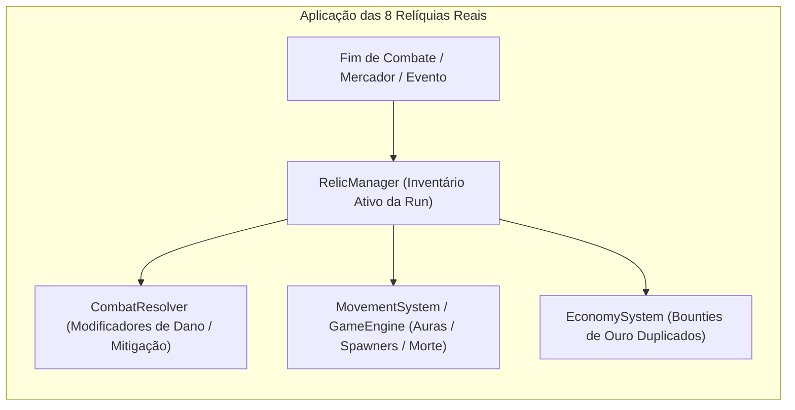
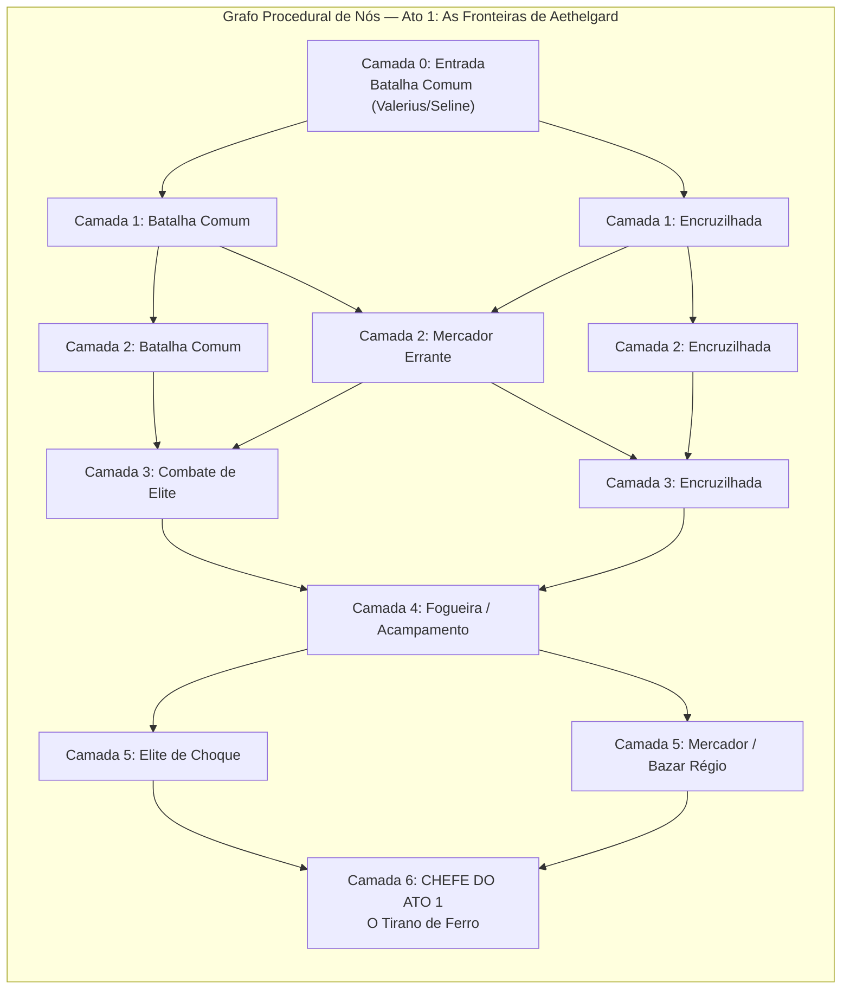

# Parecer de Sign-Off da Sprint 2 & Especificação Técnica de Game Design — Sprint 3
# Tug of War: Citadels of Aethelgard

> **Documento Normativo de Game Design & Arquitetura Roguelike**  
> **Status:** **OFICIALMENTE APROVADO & HOMOLOGADO (SIGN-OFF DA SPRINT 2 CONCEDIDO COM CORREÇÕES P0)**  
> **Autor:** Game Systems & Balance Designer  
> **Destinatários:** Gerente de Projetos (GP), Engenheiro de Core & IA (`core-architect`), Engenheiro de Gameplay & UI (`gameplay-ui-engineer`), Engenheiro de QA (`qa-automation`)  
> **Data de Homologação:** Novembro de 2026  
> **Versão de Referência:** [`docs/GDD.md`](./GDD.md) (v1.1 Harmonizado), [`docs/GOVERNANCE.md`](./GOVERNANCE.md), [`docs/SPRINT_2_REPORT.md`](./SPRINT_2_REPORT.md)  

---

## Sumário
1. [Seção 1 — Parecer Oficial de Game Design da Sprint 2 & Correções P0](#seção-1--parecer-oficial-de-game-design-da-sprint-2--correções-p0)
   - 1.1 Homologação Formal da Sprint 2 ("DE ACORDO / SIGN-OFF CONCEDIDO")
   - 1.2 [P0-1: Estado "Guardar Ouro" (Save Gold) no AIController.ts]
   - 1.3 [P0-2: Estabilidade de Cliques no DOM do Grid 4x3 (TacticalHud.ts)]
2. [Seção 2 — Especificação Matemática Estrita das 8 Relíquias Reais (GDD Seção 5.2)](#seção-2--especificação-matemática-estrita-das-8-relíquias-reais-gdd-seção-52)
   - 2.1 Visão Geral e Arquitetura do Catálogo de Relíquias
   - 2.2 Detalhamento Matemático das 8 Relíquias (20 TPS)
   - 2.3 Tabela Mestra Paramétrica para TypeScript
3. [Seção 3 — Especificação do Grafo Procedural da Campanha Roguelike (GDD Seção 5.1)](#seção-3--especificação-do-grafo-procedural-da-campanha-roguelike-gdd-seção-51)
   - 3.1 Topologia do Grafo do Ato 1 (7 Camadas / Colunas 0 a 6)
   - 3.2 Máquina de Estados da Campanha e Persistência do HP da Cidadela
   - 3.3 Especificação dos Nós Especiais (Fogueira, Mercador e 3 Eventos de Encruzilhada)
   - 3.4 Persistência em LocalStorage e Isolamento Arquitetural Headless

---

## Seção 1 — Parecer Oficial de Game Design da Sprint 2 & Correções P0

### 1.1 Homologação Formal da Sprint 2 ("DE ACORDO / SIGN-OFF CONCEDIDO")
Na qualidade de **Game Systems & Balance Designer**, realizei a auditoria técnica de conformidade do relatório [`docs/SPRINT_2_REPORT.md`](./SPRINT_2_REPORT.md), dos sistemas em `src/core/`, do renderizador Phaser 3 em `src/renderer/` e da suíte automatizada de QA (`tests/`).

> [!IMPORTANT]
> **PARECER OFICIAL DE GAME DESIGN:** **DE ACORDO / SIGN-OFF CONCEDIDO**.  
> Todas as entregas previstas para a Sprint 2 foram implementadas com fidelidade matemática e arquitetural:
> 1. As 3 correções P0 da Sprint 1 foram validadas: `Y-Steering` a $260\text{ px}$ convergindo unidades melee em $Y$, exclusão do alvo primário no dano splash e ativação canônica do *Golpe Esmagador* no 3º ataque com knockback de $20\text{ px}$ clampeado.
> 2. O arsenal das **10 Unidades e Habilidades da Facção Reino da Coroa Solar** está integralmente calibrado no motor headless a $20\text{ TPS}$.
> 3. O controlador de IA (`AIController`) opera nos ciclos determinísticos de $1.0\text{ s}$ com os 4 perfis (*Valerius*, *Thorne*, *Seline* e *O Tirano de Ferro* com o *Altar dos Renegados* invocando o *Guerreiro Colossal*).
> 4. A camada Phaser 3 interpola suavemente a $60\text{ FPS}$ via `SnapshotInterpolator` e `VisualObjectPool`.
> 5. A suíte automatizada expandiu para **111 testes verdes em 10 arquivos**, mantendo tempo total de execução de $\sim 1.3\text{ s}$.

Contudo, nossa auditoria gerencial identificou **2 Correções Mandatórias de Prioridade P0** que devem ser aplicadas na abertura imediata da Sprint 3 para garantir a integridade macro-estratégica e a usabilidade do jogo no navegador:

---

### 1.2 [P0-1: Estado "Guardar Ouro" (`Save Gold`) no `AIController.ts`]

#### 1. Diagnóstico do Problema
No código entregue da Sprint 2 ([`src/core/ai/AIController.ts`](../src/core/ai/AIController.ts)), identificamos que a IA é incapaz de acumular quantias de ouro superiores a $120\text{g}$ em partidas reais:
- Na estratégia agressiva de Valerius (`runAggressiveStrategy`), o passo 2 (`stepIndex === 2`) tem a intenção de erguer um Estábulo de Guerra (`bldg_stable_1`) que custa **$140\text{g}$** no Slot 2. Quando a IA atinge o tick de decisão com $100\text{g} \text{ a } 125\text{g}$, a checagem `if (gold >= 140)` falha, porém a função **não executa `return;`**.
- O fluxo de execução despenca até a avaliação geral da matriz de decisão (`evaluateDecisionMatrix`), onde o fallback final encontra o Slot 2 vazio e gasta os $100\text{g}$ acumulados para construir um **Quartel N1 (`bldg_barracks_1`)** indesejado, zerando o tesouro da IA e corrompendo a ordem de construção.
- O mesmo comportamento anômalo ocorre com Thorne (`runDefensiveStrategy`) ao poupar para a Forja de Cerco ($160\text{g}$) ou para a Catapulta ($210\text{g}$), e na matriz reativa quando o jogador gera $\text{Ameaça}_{\text{Pesada}} > 1200$: a IA deseja construir uma Torre Arcana ($125\text{g}$), mas ao atingir $100\text{g}$, em vez de poupar por mais um ciclo de renda, gasta os $100\text{g}$ em um Quartel genérico.

```mermaid
flowchart TD
    A["Tick de IA (a cada 20 ticks / 1.0s)"] --> B{"Está executando passo de abertura?"}
    B -->|Sim| C{"Slot alvo livre & Ouro < Custo do Passo?"}
    C -->|Sim| D["P0-1: return; // GUARDAR OURO para o passo planejado"]
    C -->|Não (Ouro >= Custo)| E["Construir estrutura do passo e avançar stepIndex"]
    B -->|Não| F{"Condição de Contra-Ataque Prioritária Ativa?"}
    F -->|Sim| G{"Slot livre / T1 upgrade & Ouro < Custo de Resposta?"}
    G -->|Sim| H["P0-1: return; // GUARDAR OURO para o contra-ataque"]
    G -->|Não| I["Construir resposta prioritária (Arcana/Estábulo/Cerco)"]
    F -->|Não| J["Fallback genérico: Upgrade T1 ou Quartel N1"]
```

#### 2. Regra Canônica P0-1 (Implementação Mandatória no `AIController.ts`):
1. **Pausa de Poupança nas Ordens de Construção Iniciais:**
   Nas sequências iniciais de abertura (`runAggressiveStrategy` e `runDefensiveStrategy`), se o slot alvo estiver vago (ou a estrutura N1 estiver pronta para upgrade) mas `gold < custoNecessario`, a IA deve emitir imediatamente:
   ```typescript
   // Se a cidadela não estiver sob perigo iminente (frontlineX <= 1400), poupar para o plano
   if (frontlineX <= 1400) {
     return; // Guardar Ouro para o próximo passo planejado da build order
   }
   ```
2. **Pausa de Poupança na Matriz de Contra-Ataque (`evaluateDecisionMatrix`):**
   Quando uma ameaça crítica do jogador for detectada:
   - $\text{Ameaça}_{\text{Cerco}} \ge 2$ (requer Estábulo: $140\text{g}$ build ou $175\text{g}$ upgr);
   - $\text{Ameaça}_{\text{Pesada}} > 1200$ (requer Torre Arcana: $125\text{g}$ build ou $160\text{g}$ upgr);
   - $\text{Ameaça}_{\text{Leve}} > 800$ (requer Arquearia: $90\text{g}$ build ou $120\text{g}$ upgr);
   Se houver slot livre disponível (ou estrutura T1 apta para upgrade) e a IA ainda não atingiu o custo exato daquela resposta prioritária, a IA **não pode cair no fallback genérico de construir Quartel N1**. Ela deve retornar imediatamente (`return;`), reservando o saldo para adquirir o contra-ataque mandatório no próximo ciclo de renda.

---

### 1.3 [P0-2: Estabilidade de Cliques no DOM do Grid 4x3 (`TacticalHud.ts`)]

#### 1. Diagnóstico do Problema
No HUD tático entregue ([`src/ui/hud/TacticalHud.ts`](../src/ui/hud/TacticalHud.ts)), o método `updateConstructionGrid()` é chamado pelo loop visual a cada frame de animação ($60\text{ FPS} \approx 16.6\text{ ms}$ por chamada):
- A função recria a string completa de HTML e executa incondicionalmente:
  ```typescript
  this.elSlotsGrid.innerHTML = html; // Executado 60 vezes por segundo!
  ```
- No modelo de eventos dos navegadores modernos (W3C DOM), um clique de mouse do usuário compreende a sequência `mousedown` $\to$ tempo de pressão $\to$ `mouseup`. Uma pressão média de botão dura entre $70\text{ ms}$ e $150\text{ ms}$.
- Como os nós `<button>` do grid são destruídos e recriados do zero a cada $16.6\text{ ms}$, o elemento que recebeu o `mousedown` é removido da árvore do DOM antes que o usuário solte o botão (`mouseup`). O navegador descarta o evento e o `click` jamais é disparado, frustrando a interação do jogador na maioria das tentativas.

#### 2. Regra Canônica P0-2 (Implementação Mandatória no `TacticalHud.ts`):
O `TacticalHud` deve adotar o padrão de **Renderização Condicional por Assinatura de Estado (*State Signature Memoization*)**:
1. Armazenar uma propriedade privada `lastGridSignature: string = ''`.
2. A assinatura do grid deve sintetizar exclusivamente os elementos que afetam a estrutura HTML:
   - `openBuildMenuSlotIndex` (slot que está com menu aberto);
   - A lista de `structureId` dos 12 slots do jogador;
   - As faixas de acessibilidade econômica de `playerGold` para os custos relevantes:
     $$\text{faixas} = [60, 90, 100, 110, 120, 125, 130, 140, 160, 175, 180, 210, 270]$$
     *(Uma mudança no ouro do jogador só altera a assinatura se cruzar o limiar de compra de alguma estrutura ou upgrade).*
3. **Fluxo de Atualização no Loop de 60 FPS:**
   - Se `currentGridSignature !== this.lastGridSignature`: re-renderiza o HTML via `this.elSlotsGrid.innerHTML = html` e atualiza a assinatura armazenada.
   - Se a assinatura for idêntica: **não toca no `innerHTML`**! Atualiza exclusivamente a largura das barras de progresso de spawn (`bar.style.width = ...`) e os textos de contagem (`span.textContent = ...`) através de seletores DOM diretos (`querySelector` em atributos `data-progress-slot="${i}"`).
4. Essa correção garante **estabilidade absoluta de nós no DOM**, permitindo cliques suaves, responsivos e instantâneos para o jogador.

---

### 1.4 [P0-3: Pré-Filtro da *Aura de Devoção* (`hasPaladinAura`) em `GameEngine.ts` para Performance $< 5.0\text{ ms/tick}$]

#### 1. Diagnóstico de Performance no Stress Test de 200 Unidades
Em `StressTest200Units.test.ts` (100 vs 100 unidades concentradas na linha de frente, incluindo 60 unidades com ataque em área e dezenas de poças de Fogo Grego ativas), cada ataque de *Supernova*, *Splash* ou pulso de *Poça de Fogo Grego* invoca `this.hasPaladinAura(target)` para cada um dos $\sim 100$ alvos no raio, e `hasPaladinAura` percorre novamente o array completo de $200$ unidades (`this.units.some(...)`), gerando complexidade cúbica $O(N_{\text{AoE}} \times N_{\text{alvos}} \times N_{\text{unidades}})$ e elevando o tick médio em máquinas sob carga para $\sim 6\text{ a }9\text{ ms}$ (acima da meta de $< 5.0\text{ ms}$ da Seção 7.3.2 do GDD).

#### 2. Regra Canônica P0-3:
No início de cada `tick()` (ou `updateCombat()` / `updateHazards()`), pré-filtrar uma única vez a lista curta de Paladinos vivos (`const alivePaladins = this.units.filter(u => u.currentHp > 0 && u.typeId === 'unit_dawn_paladin')`) ou pré-computar um `Set<string>` / flag booleana por unidade no início do tick, reduzindo o custo de `hasPaladinAura` em $> 10\times$ e mantendo o `StressTest200Units.test.ts` folgadamente em $\sim 1.5\text{ ms/tick}$.

---

## Seção 2 — Especificação Matemática Estrita das 8 Relíquias Reais (GDD Seção 5.2)

### 2.1 Visão Geral e Arquitetura do Catálogo de Relíquias
O sistema de relíquias constitui o pilar de construção de *builds* emergentes do metagame Roguelike. As relíquias são cadastradas em catálogo imutável em `src/core/config/RelicsCatalog.ts` e aplicadas diretamente na simulação lógica determinística a $20\text{ TPS}$.



---

### 2.2 Detalhamento Matemático das 8 Relíquias (20 TPS)

#### 1. `relic_solar_martyrdom` — Decreto do Martírio Solar
- **Raridade:** Rara | **Preço Base no Mercador:** $130\text{g}$ de Campanha.
- **Gatilho Determinístico:** Evento `UnitDied`.
- **Condição Matemática:** 
  $$\text{victim.team} = \text{'PLAYER'} \quad \land \quad \text{victim.isMelee} = \text{true}$$
  *(Válido para Escudeiro, Cavaleiro Real, Lanceiro Montado e Paladino da Alvorada).*
- **Efeito Numérico:** No exato tick da morte da unidade, emite uma explosão radial centrada em $(X_{\text{morte}}, Y_{\text{morte}})$ com raio de $\mathbf{80\text{ px}}$:
  $$\Delta d^2 = (X_i - X_{\text{morte}})^2 + (Y_i - Y_{\text{morte}})^2 \le 80^2 = 6400$$
  - Todas as unidades vivas do time inimigo (`ENEMY`) dentro do raio sofrem **$60\text{ de Dano Mágico}$ base**.
  - O dano é mitigado individualmente pela fórmula padrão de combate:
    $$\text{Dano Efetivo} = \max\left(1, \lfloor (60 \times M_{\text{Mágico vs Armadura}}) - \text{Redução Plana} \rfloor\right)$$
- **Casos de Borda:** A Cidadela adversária é imune ao dano de Martírio Solar. Aliados não sofrem fogo amigo.

#### 2. `relic_febrile_production` — Doutrina da Produção Febril
- **Raridade:** Incomum | **Preço Base no Mercador:** $90\text{g}$ de Campanha.
- **Efeito Contínuo em Estruturas:**
  - Reduz o tempo de cooldown de produção de todas as estruturas do jogador em $\mathbf{-15\%}$:
    $$\text{totalSpawnCooldownTicks} = \max(1, \text{round}(\text{spawnCooldownSec} \times 0.85 \times \text{TICK\_RATE}))$$
- **Penalidade Contínua em Unidades:**
  - Todas as unidades aliadas (`team === 'PLAYER'`) são geradas com HP Máximo e HP Inicial reduzidos em $\mathbf{-10\%}$:
    $$\text{maxHp} = \max(1, \lfloor \text{unitDef.maxHp} \times 0.90 \rfloor), \quad \text{currentHp} = \text{maxHp}$$
- **Casos de Borda:** Afeta todas as 5 linhas de estruturas e upgrades N2. A Cidadela Aliada não tem seu HP reduzido (apenas unidades móveis geradas).

#### 3. `relic_flaming_dawn_bolts` — Virotes da Alvorada Flamejante
- **Raridade:** Rara | **Preço Base no Mercador:** $130\text{g}$ de Campanha.
- **Gatilho Determinístico:** No disparo de ataque de atiradores aliados (`unit_longbowman` ou `unit_siege_crossbowman`).
- **Condição Matemática:** 
  $$(\text{unit.attackCount} + 1) \% 5 === 0$$
- **Efeito Numérico:** O disparo desencadeia uma detonação ígnea de raio de $\mathbf{70\text{ px}}$ centrada no ponto de impacto do projétil:
  - O alvo primário sofre o dano normal do virote/flecha **mais** o dano da explosão.
  - Todas as unidades inimigas na área de $70\text{ px}$ sofrem **$160\text{ de Dano Mágico}$ base**, mitigado por suas respectivas armaduras e reduções planas.
- **Casos de Borda:** Cidadela atingida sofre o dano mágico da explosão mitigado por sua Armadura Fortificada ($0.50\times$).

#### 4. `relic_blood_and_soil_banner` — Estandarte de Sangue e Solo
- **Raridade:** Comum | **Preço Base no Mercador:** $60\text{g}$ de Campanha.
- **Condição Matemática Contínua:** 
  $$\text{frontline.frontlineX} > 1200$$
- **Efeito Numérico:** Enquanto a frente de combate permanecer em território inimigo, todas as unidades aliadas recebem:
  $$\text{relicDamageMultiplier} = 1.20 \quad (+20\% \text{ de Dano Global})$$
- **Casos de Borda:** Se $\bar{X}_{\text{front}}$ recuar para $\le 1200$, o bônus é desligado imediatamente no mesmo tick.

#### 5. `relic_blessed_heavy_plating` — Blindagem Benta dos Justos
- **Raridade:** Incomum | **Preço Base no Mercador:** $90\text{g}$ de Campanha.
- **Condição Matemática em `CombatResolver`:**
  $$\text{defender.team} = \text{'PLAYER'} \quad \land \quad \text{defender.armorType} = \text{'HEAVY'} \quad \land \quad \text{damageType} \in \{\text{'NORMAL'}, \text{'PIERCING'}\}$$
- **Efeito Numérico:** Adiciona $+2$ pontos inteiros à redução plana de armadura da unidade defensora:
  $$\text{effectiveFlatReduction} = \text{defenderFlatReduction} + 2$$
- **Casos de Borda:** Não concede mitigação contra Dano Mágico (`MAGIC`) ou de Cerco (`SIEGE`). O dano final nunca é reduzido a zero (piso mínimo garantido: $\max(1, \dots)$).

#### 6. `relic_triumphant_dawn_charge` — Carga da Alvorada Triunfante
- **Raridade:** Épica | **Preço Base no Mercador:** $170\text{g}$ de Campanha.
- **Condição Matemática:** Disparado no primeiro impacto de carga (`isChargeAttack === true`) de unidades montadas aliadas (`unit_mounted_spearman` ou `unit_dawn_paladin`).
- **Efeito Numérico:**
  1. **Amplificação Massiva de Impacto:** Adiciona $+1.50\times$ ao multiplicador de carga:
     - Lanceiro Montado: passa de $2.00\times$ para **$3.50\times$ de Dano Normal**.
     - Paladino da Alvorada: passa de $2.50\times$ para **$4.00\times$ de Dano Normal**.
  2. **Atordoamento Prolongado (*Stun*):** Inflige $\mathbf{30\text{ ticks}}$ ($1.5\text{ s}$) de atordoamento no alvo primário atingido:
     $$\text{target.stunTicksRemaining} = 30$$
     *(O Lanceiro passa a infligir stun de 1.5s, e o Paladino tem seu stun estendido de 1.0s para 1.5s).*
- **Casos de Borda:** A Cidadela inimiga recebe o dano amplificado, mas possui imunidade absoluta ao efeito de Stun.

#### 7. `relic_royal_war_tithe` — Dízimo de Guerra Régio
- **Raridade:** Comum | **Preço Base no Mercador:** $60\text{g}$ de Campanha.
- **Condição Matemática em `GameEngine.updateCombat()`:**
  $$\text{killer.team} = \text{'PLAYER'} \quad \land \quad \text{killingDamageType} \in \{\text{'MAGIC'}, \text{'SIEGE'}\}$$
  *(Abrange ataques de Aprendiz Solar, Arquimago, Balista, Catapulta, Poça de Fogo Grego, Supernova e explosões de relíquias).*
- **Efeito Numérico:** O bounty de ouro creditado ao tesouro do jogador no abate é multiplicado por $2$:
  $$\text{bountyConcedido} = \text{unitDef.bountyGold} \times 2$$
- **Casos de Borda:** Não se aplica a abates realizados por unidades de dano Normal ou Perfurante (Escudeiro, Cavaleiro, Arqueiro, Besteiro e Lanceiro).

#### 8. `relic_citadel_mana_heart` — Coração de Mana da Cidadela
- **Raridade:** Épica | **Preço Base no Mercador:** $170\text{g}$ de Campanha.
- **Gatilho Periódico:** A cada **$600\text{ ticks}$ ($30.0\text{ s}$)** exatos de batalha (`tick > 0 && tick % 600 === 0`).
- **Efeito Duplo Global:**
  1. **Onda Curativa Aliada:** Todas as unidades vivas do jogador (`PLAYER`) recuperam **$+120\text{ HP}$**:
     $$\text{unit.currentHp} = \min(\text{unit.maxHp}, \text{unit.currentHp} + 120)$$
  2. **Pulso de Purificação Inimigo:** Todas as unidades vivas do inimigo (`ENEMY`) em campo sofrem **$80\text{ de Dano Mágico}$ base**, mitigado individualmente por suas armaduras e reduções planas.
- **Casos de Borda:** A Cidadela adversária não sofre dano da onda global. A Cidadela Aliada não recebe cura deste pulso (apenas as tropas móveis em campo).

---

### 2.3 Tabela Mestra Paramétrica para TypeScript

```typescript
export type RelicRarity = 'COMMON' | 'UNCOMMON' | 'RARE' | 'EPIC';

export type RelicTypeId =
  | 'relic_solar_martyrdom'
  | 'relic_febrile_production'
  | 'relic_flaming_dawn_bolts'
  | 'relic_blood_and_soil_banner'
  | 'relic_blessed_heavy_plating'
  | 'relic_triumphant_dawn_charge'
  | 'relic_royal_war_tithe'
  | 'relic_citadel_mana_heart';

export interface RelicDefinition {
  readonly id: RelicTypeId;
  readonly name: string;
  readonly rarity: RelicRarity;
  readonly merchantCostGold: number;
  readonly description: string;
}
```

| ID da Relíquia | Nome Canônico | Raridade | Preço (Campanha) | Efeito Técnico Estrito |
| :--- | :--- | :---: | :---: | :--- |
| `relic_solar_martyrdom` | Decreto do Martírio Solar | RARA | 130g | Morte de melee aliada $\to$ AoE $80\text{ px}$, $60$ Dano Mágico base |
| `relic_febrile_production` | Doutrina da Produção Febril | INCOMUM | 90g | $-15\%$ spawn cooldown ticks nas estruturas; $-10\%$ HP máx nas unidades |
| `relic_flaming_dawn_bolts` | Virotes da Alvorada Flamejante | RARA | 130g | Cada 5º ataque de atirador $\to$ explosão $70\text{ px}$ com $160$ Dano Mágico base |
| `relic_blood_and_soil_banner` | Estandarte de Sangue e Solo | COMUM | 60g | $\bar{X}_{\text{front}} > 1200 \to +20\%$ dano global para unidades aliadas |
| `relic_blessed_heavy_plating` | Blindagem Benta dos Justos | INCOMUM | 90g | Aliado HEAVY vs dano Normal/Piercing $\to +2$ Redução Plana de Armadura |
| `relic_triumphant_dawn_charge`| Carga da Alvorada Triunfante | ÉPICA | 170g | Cavalaria aliada em carga: $+1.50\times$ dano ($3.50\times / 4.00\times$) + $1.5\text{s}$ Stun |
| `relic_royal_war_tithe` | Dízimo de Guerra Régio | COMUM | 60g | Abates com dano Mágico ou Cerco concedem $+100\%$ Bounty em ouro |
| `relic_citadel_mana_heart` | Coração de Mana da Cidadela | ÉPICA | 170g | A cada $30.0\text{s}$ ($600\text{ ticks}$): cura $+120\text{ HP}$ aliados, $80$ Mágico em inimigos |

---

## Seção 3 — Especificação do Grafo Procedural da Campanha Roguelike (GDD Seção 5.1)

### 3.1 Topologia do Grafo do Ato 1 (7 Camadas / Colunas 0 a 6)
A jornada do Ato 1 é gerada proceduralmente a partir da semente da run (`seed`) através de um grafo direcionado acíclico (DAG) com **7 colunas de nós**:



#### Definição das 7 Camadas:
- **Camada 0 (Nó Único de Entrada):** `BATTLE` (Enfrenta Comandante Valerius ou Rainha Seline em configuração padrão).
- **Camada 1 (2 Nós):** 1 `BATTLE` e 1 `EVENT`.
- **Camada 2 (3 Nós):** 1 `BATTLE`, 1 `MERCHANT` e 1 `EVENT`.
- **Camada 3 (2 Nós):** 1 `ELITE` (Inimigo com $+20\%$ de HP ou $+30\text{g}$ de ouro inicial de batalha) e 1 `EVENT`.
- **Camada 4 (1 Nó de Retaguarda):** `CAMPFIRE` (Fogueira da Guarda — recuperação estratégica obrigatória).
- **Camada 5 (2 Nós):** 1 `ELITE` e 1 `MERCHANT`.
- **Camada 6 (Nó Final do Ato):** `BOSS` (*O Tirano de Ferro* — Chefe do Ato 1 com o *Altar dos Renegados*).

---

### 3.2 Máquina de Estados da Campanha e Persistência do HP da Cidadela

#### O Eixo Central do Desafio Roguelike:
Ao contrário de batalhas isoladas de arcade, **o HP da Cidadela Aliada persiste de uma batalha para a seguinte**. Se o jogador terminar uma batalha comum com o Nexus em $1400 / 2500\text{ HP}$, ele iniciará o próximo combate exatamente com $1400\text{ HP}$. A integridade da fortaleza só é restaurada através de decisões de Acampamento, poções do Mercador ou conclusão vitoriosa do Ato.

```typescript
export interface CampaignState {
  readonly runSeed: number;
  readonly act: number; // 1 no MVP
  currentLayer: number; // 0..6
  currentNodeId: string;
  visitedNodeIds: string[];
  
  // Persistência Vital
  playerCitadelHp: number; // Max 2500
  campaignGold: number;    // Ouro persistente da campanha (inicia com 50g)
  
  // Baralho de Relíquias e Modificadores
  activeRelicIds: RelicTypeId[];
  campaignDamageBonus: number; // Acumulado na Forja de Campo (+10% por uso)
  nextBattleBonusGold: number; // Bônus temporário para o próximo combate (+50g)
  
  isRunOver: boolean;
  isVictory: boolean;
}
```

#### Economia de Campanha vs. Economia de Batalha:
- **Ouro de Campanha (`campaignGold`):** Recursos do soberano acumulados entre batalhas.
  - Recompensa ao vencer Batalha Comum: **$+50\text{g}$**.
  - Recompensa ao vencer Batalha de Elite: **$+100\text{g}$** + Escolha de 1 entre 3 Relíquias.
  - Recompensa ao vencer o Chefe do Ato: **$+150\text{g}$** + Vitória do Ato 1.
  - Utilizado exclusivamente para transações no Mercador e em escolhas de Eventos.
- **Ouro Tático de Batalha:** Recursos em tempo real da partida. Começa em $120\text{g}$ (ou $120\text{g} + \text{nextBattleBonusGold}$). Não transita entre nós.

---

### 3.3 Especificação dos Nós Especiais

#### 1. Nó de Acampamento / Fogueira da Guarda (`CAMPFIRE`)
Ao acampar, o jogador é apresentado a exatamente **3 opções estratégicas**, devendo escolher **obrigatoriamente uma**:
1. **Reparar Muralhas (*Repair Citadels*):** Restaura $+35\%$ do HP máximo da Cidadela ($+875\text{ HP}$), clampeado no teto de $2500\text{ HP}$:
   $$\text{playerCitadelHp} = \min(2500, \text{playerCitadelHp} + 875)$$
2. **Forja de Campo (*Field Forge*):** Aprimora permanentemente o armamento da armada. Concede $+10\%$ de dano cumulativo para todas as tropas pelo restante da Run:
   $$\text{campaignDamageBonus} += 0.10$$
3. **Inspiração Soberana (*Sovereign Inspiration*):** Reorganiza suprimentos de marcha. A próxima batalha começa com $+50\text{g}$ de ouro tático adicional ($170\text{g}$ de saldo de abertura):
   $$\text{nextBattleBonusGold} += 50$$

#### 2. Nó de Mercador Errante (`MERCHANT`)
Oferece um catálogo dinâmico de compras com base no `campaignGold`:
- **Venda de 3 Relíquias Aleatórias da Pool:**
  - Relíquia Comum: $60\text{g}$ de Campanha.
  - Relíquia Incomum: $90\text{g}$ de Campanha.
  - Relíquia Rara: $130\text{g}$ de Campanha.
  - Relíquia Épica: $170\text{g}$ de Campanha.
- **Reparo Emergencial de Engenharia:**
  - Custo: $40\text{g}$ de Campanha $\to$ Recupera $+500\text{ HP}$ imediatos da Cidadela.

#### 3. Os 3 Eventos de Encruzilhada Canônicos (`EVENT`)
Eventos narrativos com escolhas determinísticas de dilema moral e balanço risco-recompensa:

##### Evento 1: *O Comboio de Suprimentos Reais*
> *"Nas colinas de Aethelgard, vossos batedores interceptam uma caravana de intendência abandonada, cercada por mercenários famintos."*
- **Opção A — Pagar escolta armada e resgatar o tesouro:**
  - Custo: $-30\text{g}$ de Ouro de Campanha.
  - Ganho: O jogador recebe **1 Relíquia Incomum ou Rara aleatória** garantida.
- **Opção B — Saquear suprimentos de emergência:**
  - Custo: $-300\text{ HP}$ da Cidadela (tropas indisciplinadas sofrem baixas no tumulto).
  - Ganho: $+80\text{g}$ de Ouro de Campanha imediatos.

##### Evento 2: *O Santuário Solar Profanado*
> *"Um antigo templo dos Teurgistas Solares arde em chamas corruptas. Os monges suplicam por vosso sangue nobre para purificar o fogo."*
- **Opção A — Sacrificar a fortaleza em devoção mística:**
  - Custo: $-400\text{ HP}$ da Cidadela.
  - Ganho: Adquire instantaneamente o **Decreto do Martírio Solar** (`relic_solar_martyrdom`).
- **Opção B — Financiar a bênção das forjas:**
  - Custo: $-50\text{g}$ de Ouro de Campanha.
  - Ganho: Adquire instantaneamente a **Blindagem Benta dos Justos** (`relic_blessed_heavy_plating`).

##### Evento 3: *O Desertor da Guarda de Ferro*
> *"Um veterano renegado do Tirano de Ferro oferece plantas secretas das fortificações inimigas em troca de perdão real."*
- **Opção A — Contratar as plantas de cerco:**
  - Custo: $-40\text{g}$ de Ouro de Campanha.
  - Ganho: Concede $+100\text{g}$ de Ouro Tático Inicial na próxima batalha (`nextBattleBonusGold += 100`).
- **Opção B — Enforcar o traidor para restaurar a disciplina:**
  - Custo: Nenhum custo de ouro.
  - Ganho: Moral de ferro restaura $+300\text{ HP}$ da Cidadela Aliada.

---

### 3.4 Persistência em `localStorage` e Isolamento Arquitetural Headless

Em cumprimento estrito à **Regra de Ouro Arquitetural da Seção 2 de [`docs/GOVERNANCE.md`](./GOVERNANCE.md)**:

> [!CAUTION]
> **Proibição Absoluta em `src/core/`:** As classes do núcleo de simulação (`CampaignManager.ts`, `GameEngine.ts`, `CombatResolver.ts`) não podem conter referências a `localStorage`, `window` ou APIs de navegador.

#### Estratégia Canônica de Salvamento:
1. `src/core/campaign/CampaignManager.ts` opera de forma pura e determinística em TypeScript headless, expondo métodos como `serialize(): string` (JSON limpo) e `static deserialize(json: string): CampaignManager`.
2. A camada de persistência reside na fronteira da UI (`src/ui/storage/CampaignStorage.ts`):
   - Chave de armazenamento: `'tug_of_war_campaign_save_v1'`.
   - Salva automaticamente após cada vitória de batalha, escolha de acampamento, compra em mercador ou encerramento de evento.
   - Permite ao jogador recarregar a página e continuar sua campanha exatamente no mesmo nó, com as mesmas relíquias e o mesmo HP de Cidadela.

---

## 4. Matriz de Entregáveis da Sprint 3 para a Engenharia

| Módulo / Tarefa | Escopo Técnico | Critério de Aceite / Teste |
| :--- | :--- | :--- |
| **Correção P0-1** | `AIController.ts` | Valerius e Thorne poupam ouro para seus passos sem cair no fallback; IA poupa para contra-ataques prioritários. |
| **Correção P0-2** | `TacticalHud.ts` | Memoização por assinatura de estado no grid; cliques 100% responsivos no navegador sem drop de eventos. |
| **Motor de Relíquias** | `src/core/config/RelicsCatalog.ts` e `RelicManager.ts` | 8 Relíquias operacionais a $20\text{ TPS}$ com cobertura de testes unitários para cada efeito matemático. |
| **Grafo Roguelike** | `src/core/campaign/` | Geração do DAG de 7 camadas por seed, nós de Batalha, Elite, Fogueira, Mercador e 3 Eventos. |
| **Persistência de HP** | `CampaignManager.ts` | HP da Cidadela persiste entre batalhas; reparos na Fogueira e Mercador respeitam o teto de 2500 HP. |
| **Telas de Metagame UI** | `src/ui/screens/` | Tela do Mapa de Nós, Tela de Acampamento, Tela do Mercador, Tela de Evento e Tela de Vitória da Run. |

---
*Assinado digitalmente:*  
**Game Systems & Balance Designer**  
*Tug of War: Citadels of Aethelgard — Equipe de Game Design*
